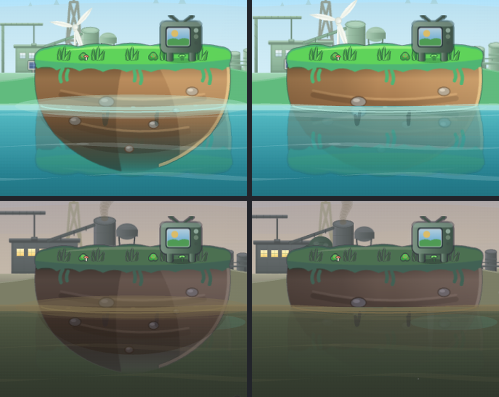
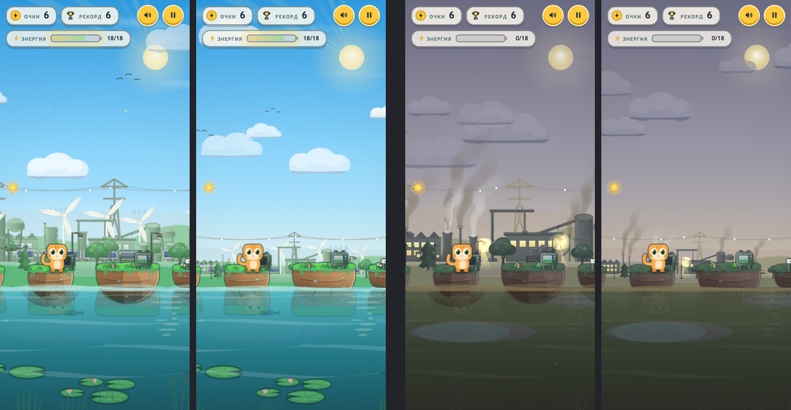
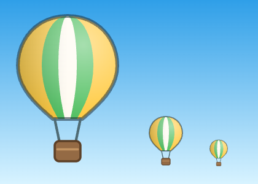

# Энергопрыжок v11 — Graphics Update: Implementation Plan

> **For agentic workers:** REQUIRED SUB-SKILL: Use superpowers:subagent-driven-development (recommended) or superpowers:executing-plans to implement this plan task-by-task. Steps use checkbox (`- [ ]`) syntax for tracking.

**Goal:** Make v11 look cleaner and calmer. Islands should sit *in* the water instead of floating over it as bowls behind a glass stripe. Island soil gets soft light instead of hard seams. On phones held upright, the background stops towering over the hero. A hot-air balloon crosses the clean sky as a reward.

**Architecture:** Every change goes into a new `clean-hop-v11/` folder, copied from `clean-hop-v10/`. The island art is generated by `tools/art/islands.py`, so the soft light is a generator change and the 10 sprites are regenerated. The waterline becomes one helper, `drawIslandBody()`, used by both the islands and the finish bank. It draws three things: the part under the water (dim, tinted, wavering), the reflection, and the sprite clipped at the waterline. The background gets its own size ruler `SU`. On landscape screens `SU` equals `VH`, so nothing changes there; on upright phones it follows the width.

**Tech Stack:** Single-file `index.html` (ES5 inside a `'use strict'` IIFE, Canvas 2D), SVG sprites, a `sw.js` offline cache, and the Python and headless-Chrome tools in `tools/` (`check.py`, `run-scenario.py`, `scenarios.py`, `shots.py`, `look.py`).

**Spec:** This plan is its own spec. §1 says what is wrong today, §2 lists the decisions, and §3 says what v11 must look like. The measurements and preview images were taken on 2026-10-08 from v10 (commit `6241be2`) and from a throwaway prototype of Tasks 1–3. The prototype lived only in a temp folder; no repo file was changed.

---

## 1. What's wrong in v10 today

Screenshots taken with `tools/shots.py` at 1280×720, 844×390 and 390×844, at clean levels 0, 0.5 and 1:

| # | Problem | What you see | Measured (v10) |
|---|---|---|---|
| P1 | **Glass stripe at the waterline** | A pale band (the foam "halo", `drawStone`) lies across every island where it meets the water. The island looks as if it sits behind a pane of glass. | Soil just above the water is **+12 (dirty) to +32 (clean)** brighter than soil higher up |
| P2 | **A second island under the water** | The whole bowl-shaped keel is drawn at full strength, and only a weak brown gradient covers it. Under the surface you see the solid island and its reflection on top of each other, so the pebbles show twice. | Submerged column is **58–104** warmer (r−b) than open water when clean |
| P3 | **Hard light seams in the soil** | The sprite's shade and light are two hard-edged wedges plus a bright rim cut off at x=150. They read as a crack down the island. | Largest column-to-column jump **7–14** luminance |
| P4 | **Background towers over the hero on upright phones** | Pylons, factories, turbines and shore trees are sized by `VH`. On 390×844 a pylon is **3.3×** the hero's height; in landscape it is **1.7×**. The skyline crowds the islands and blades cross behind the hero. | pylon/hero = 3.33 (390×844) vs 1.73 (1280×720) |
| P5 | **Clean sky is empty on upright phones** | After cleaning up, the top half of a tall screen is plain blue with two clouds. | — |

Before → after, from the prototype. Top row is clean, bottom row is dirty; left is v10, right is v11:

<p></p>

Upright phone, 390×844. From left: v10 clean, v11 clean, v10 dirty, v11 dirty:

<p></p>

The proposed balloon at 180, 60 and 32 px (its real size in game is 26–54 px wide):

<p></p>

## 2. Decisions to confirm before Task 0

Answer with one sign per number, e.g. `1 + 2 + 3 + 4 -`.

| # | Decision | Recommended |
|---|---|---|
| 1 | **Soft island light.** Replace the hard shade/light wedges and the cut-off rim with one smooth side-to-side gradient and a rim light that fades in toward the sun (Task 1). | **+** |
| 2 | **Islands sit in the water.** Cut each island at the waterline. Show the part under the water dim, water-coloured and wavering. Remove the glass stripe, and add one small ripple lapping out from each island. The finish meadow's bank gets the same treatment (Task 2). | **+** |
| 3 | **Smaller background on upright phones.** Size the far works, pylons, smoke, ridge, hills and shore by a new ruler `SU = min(VH, VW × 1.1)`. Landscape and desktop look exactly as they do now (Task 3). | **+** |
| 4 | **Hot-air balloon.** A yellow-green-cream balloon drifts slowly across the sky once the air is ≥ 60 % clean. It fades out at the menu's secret night. You can't tap it: it's just a reward to look at (Task 4). | **+** |

If a decision is **−**:
- **1 −** Skip Task 1, and delete the `seam` rule from `tools/look.py` in Task 2.
- **2 −** In Task 2, do only Steps 1–2 (the look tooling), and delete the `veil` and `under` rules from `tools/look.py`.
- **3 −** Skip Task 3. In Task 4, `balloonAt()` uses `VH` where it says `SU`.
- **4 −** Skip Task 4.

## 3. What v11 must look like (spec)

### 3.1 Island light (Task 1)
- One horizontal gradient over the soil: warm shade on the left (#3a2818, opacity .32 → .20 → 0 by 47 % of the width) and sunlight on the right (#ffd79a, 0 from 55 % → .16 → .26 at the edge). It has no hard edge anywhere.
- The bright rim along the keel stays (#ffe1a0, 7 px, opacity .6). It fades in from x=120 to x=215 through a luminance mask, so it no longer starts with a cut at x=150.
- The mirrored twins (`island-N-m.svg`) keep their light on the **right** (the sun side). The gradient and the mask sit outside the mirroring transform.
- The grass lid, drips, strata and pebbles are unchanged, and so is the island geometry (`0.1294`, `0.8706`, `islandHalfAt`).

### 3.2 Waterline (Task 2)
- Above the waterline (`groundY + 1`) the island sprite is drawn exactly as before. Below it, nothing of the solid sprite is drawn.
- The submerged rows are drawn through the water. They're tinted 60 % toward the water colours (`P.sludgeHi` → `P.sludgeLo`), laid in 6 strips that sway a little (refraction), and fade with depth. Overall alpha is 0.30 in dirty water and 0.50 in clean water. At `QUALITY` 0 they're drawn as a single strip.
- The reflection (`sprReflection`) is unchanged and lies over the submerged rows.
- The foam halo ellipses and the brown "keel fade" are removed. The crisp foam ring stays. One thin ripple ring grows from the island and fades every 2.6 s, with its phase set by the island id. It's skipped under `prefers-reduced-motion`.
- The finish meadow bank (`drawMeadow`, sprite `island-2`) goes through the same helper. Its pale filled waterline ellipse becomes a crisp ring.

### 3.3 Background ruler (Task 3)
- `SU = Math.min(VH, VW * 1.1)`, set in `layout()`.
- `SU` replaces `VH` in `drawDistantRidge`, `pylonStep`, `drawFarWorks`, `drawSmog`, `drawSkyline` and `drawShore`, and in the two `drawHills` amplitudes in `render()`.
- `VH` stays for the sky gradient, the clouds, the sun, the god rays, the motes, the foreground, the rainbow and the night sky.
- When `VW / VH ≥ 1/1.1` (every landscape screen and square-ish window), `SU === VH`, so nothing changes.
- The pylon-to-hero height ratio stays between 1.5 and 2.2 on every screen.
- Known and accepted: on 390×844 the pylon wire now runs at the hero's ear height, which is where it already runs on 1280×720.

### 3.4 Balloon (Task 4)
- Sprite `assets/sprites/balloon.svg`, 60×84 (the art is in Task 4).
- Width is `max(26, SU × 0.075)`. It's centred at `y = groundY × 0.30` and bobs ±4 px.
- It drifts right at 9 px/s with parallax 0.10, wrapping over `VW × 2.6`.
- Opacity is `clamp((cleanShown − 0.6) / 0.2, 0, 1) × (1 − night)`. It is not tappable and has no sound.

### 3.5 Not in this plan
- Hero art and faces (they stay friendly, untouched).
- HUD, menu card, picker.
- Gameplay: physics, jump, island spacing, camera, `Z`, `B`, `groundY`.
- The blocky blur behind the menu card. It shows only in headless-Chrome screenshots (software `backdrop-filter`). Check on a real phone before planning any fix.

## Global Constraints

- All work goes into the new `clean-hop-v11/` folder. Leave `clean-hop-v10/` and older folders untouched.
- Game code style: one `index.html`, ES5 (`var`, `function`, no arrow functions) inside the `'use strict'` IIFE. It must work when the file is double-clicked (`file://`), so game code never reads canvas pixels. Scenario files in `tools/scenarios/` may use modern JS, as the existing ones do.
- Every new sprite goes into both `SPRITES` (index.html) and `sw.js` `FILES`. `python3 tools/check.py` must print `OK` at the end of every task.
- `sw.js` `VERSION` is `'clean-hop-v11-1'` after Task 0 and goes up by one at the end of each later task (`-2` … `-5`).
- No gameplay changes. Hero drawing is untouched (it's a kids' game: faces always stay friendly, and v11 doesn't touch them).
- Landscape and desktop backgrounds stay identical: `SU === VH` whenever `VW / VH ≥ 1/1.1`.
- Performance: `render()` at 390×844 with CPU×4 must stay ≤ v10 × 1.25 + 0.3 ms, and the `QUALITY` tier must not drop. Checked by `tools/look.py --only perf`.
- Don't commit until the user says so. The final commit is one commit named `clean-hop v11` (Task 5).

## Review Focus

1. **The finish meadow bank** reuses `island-2`. It must meet the water exactly like the islands, with no solid bowl under the surface. Pinned in Task 2 Step 3 by a `check.py` guard: no direct `spr(isl` or `spr('island-` calls, and `drawIslandBody` is called at least twice.
2. **Mirrored islands** (`-m`, every odd island id) must keep their light on the sun side after the gradient rewrite. Pinned in Task 1 Step 1 (`check.py`: every island SVG has an untransformed `<g mask="url(#sunside)">` and `fill="url(#side)"`) and in Task 2 (`look.py` rule light ≥ +3, measured over alternating ids).
3. **Landscape screens and tablets.** Task 3 must change nothing on landscape (1024×768, 1280×720, 844×390). Tall tablets (768×1024) and narrow phones (320×640) must stay in proportion. Pinned in Task 3 by `bg-scale.js` at six sizes.
4. **Slow phones.** The extra submerged pass must not push a phone to a lower `QUALITY` tier. Pinned in Task 2 Step 7 by `look.py --only perf`.
5. **The menu's secret night** (tap the sun in the menu). The balloon must not hang in the night sky. Pinned in Task 4 by `balloon.js`, which sets `night = 1` and expects `balloonAt() === null`.

## File map

| File | Task | Change |
|---|---|---|
| `clean-hop-v11/` (whole folder) | 0 | Create: a copy of `clean-hop-v10/` |
| `clean-hop-v11/sw.js` | 0–4 | `VERSION` bumps; Task 4 adds `balloon.svg` to `FILES` |
| `tools/check.py` | 0, 1, 2 | Default game → v11; syntax-check every `<script>` (was only the last); version gate `VER`; island-light guard; island-body guard |
| `tools/test-build.py` | 0, 3, 4 | Default game → v11; hooks `SU`, `balloonAt`, `night` setter |
| `tools/shots.py`, `tools/icon/export.sh` | 0 | Default game → v11 |
| `tools/art/islands.py` | 1 | Output → v11; soft side gradient and masked rim |
| `clean-hop-v11/assets/sprites/island-{1..5}{,-m}.svg` | 1 | Regenerated |
| `tools/scenarios/look.js`, `tools/look.py` | 2 | v11 probe and rules (v10 → v11) |
| `clean-hop-v11/index.html` | 2, 3, 4 | `sprSubmerged`, `drawIslandBody`, `drawStone`, `drawMeadow`; `SU`; `balloonAt`, `drawClouds`, `SPRITES` |
| `tools/scenarios/bg-scale.js` | 3 | Create |
| `clean-hop-v11/assets/sprites/balloon.svg` | 4 | Create |
| `tools/scenarios/balloon.js` | 4 | Create |

Line numbers below are **v10** line numbers. The v11 copy starts byte-identical, and the numbers shift as tasks add code, so search for the quoted text.

---

### Task 0: Fork `clean-hop-v11` and point the tools at it

**Files:**
- Create: `clean-hop-v11/` (copy of `clean-hop-v10/`)
- Modify: `clean-hop-v11/sw.js:4`
- Modify: `tools/check.py:2,9,15-20`, `tools/test-build.py:3,18`, `tools/shots.py:4,22`, `tools/icon/export.sh:9`

**Interfaces:**
- Produces: `clean-hop-v11/` is the default `--game` for `check.py`, `test-build.py` (so also `run-scenario.py` and `scenarios.py`) and `shots.py`. It also produces the baselines `$TMPDIR/v10-scenarios.txt` and the `before` shot set used in Task 5.

- [ ] **Step 1: Copy the game**

Run from the project root (`~/Projects/milana/clean-hop`):
```bash
cp -R clean-hop-v10 clean-hop-v11
```

- [ ] **Step 2: New cache version**

In `clean-hop-v11/sw.js` line 4, change `var VERSION = 'clean-hop-v10-5';` to:
```js
var VERSION = 'clean-hop-v11-1';
```

- [ ] **Step 3: Point the tools at v11**

```bash
sed -i '' 's/clean-hop-v10/clean-hop-v11/g' tools/check.py tools/test-build.py tools/icon/export.sh
sed -i '' -e "s/# v10, tagged 'clean-hop-v10'/# v11, tagged 'clean-hop-v11'/" -e "s/default='clean-hop-v10'/default='clean-hop-v11'/" tools/shots.py
```

- [ ] **Step 4: Make `check.py` syntax-check the game itself**

Found while planning: `check.py` line 15 takes `re.findall(...)[-1]`, which is the **last** `<script>`, the 432-byte service-worker block. So `node --check` never saw the 280 KB game script. (The v10 game script does pass `node --check`; this was checked on 2026-10-08.) Every later task depends on `check.py` saying `OK`, so fix this first. Replace lines 15–20:
```python
script = re.findall(r'<script>(.*?)</script>', html, re.S)[-1]
with tempfile.NamedTemporaryFile('w', suffix='.js', delete=False) as f:
    f.write(script)
r = subprocess.run(['node', '--check', f.name], capture_output=True, text=True)
if r.returncode:
    problems.append('script syntax:\n' + r.stderr)
```
with:
```python
# every <script> block - v11: [-1] alone was only the service-worker one
for script in re.findall(r'<script>(.*?)</script>', html, re.S):
    with tempfile.NamedTemporaryFile('w', suffix='.js', delete=False) as f:
        f.write(script)
    r = subprocess.run(['node', '--check', f.name], capture_output=True, text=True)
    if r.returncode:
        problems.append('script syntax:\n' + r.stderr)
```
Prove it now catches a broken game. Break a scratch copy, never the real folder:
```bash
rm -rf "$TMPDIR/broken-v11" && cp -R clean-hop-v11 "$TMPDIR/broken-v11"
sed -i '' 's/^function clamp(v, a, b) {/function clamp(v, a, b) {{/' "$TMPDIR/broken-v11/index.html"
python3 tools/check.py --game "$TMPDIR/broken-v11"; echo "exit $?"
```
Expected: `script syntax:` followed by node's error, then `exit 1`.

- [ ] **Step 5: Verify**

Run: `python3 tools/check.py`
Expected: `OK`

Run: `grep -rn "clean-hop-v10" tools --include=*.py --include=*.sh`
Expected: only `tools/look.py` and `tools/art/islands.py` (Tasks 1 and 2 rewrite them).

- [ ] **Step 6: Record baselines**

```bash
python3 tools/scenarios.py --game clean-hop-v10 > "$TMPDIR/v10-scenarios.txt"
python3 tools/shots.py --game clean-hop-v10 --tag before
```
Expected: a list of `<name> pass|FAIL|-` lines in the txt, and `contact.html` printed by `shots.py`.

---

### Task 1: Soft island light (Decision 1)

**Files:**
- Modify: `tools/check.py` (version gate and guard, before the final `print`)
- Modify: `tools/art/islands.py:4,14` (output folder), `:105-127` (SVG template)
- Regenerate: `clean-hop-v11/assets/sprites/island-{1..5}.svg`, `island-{1..5}-m.svg`
- Modify: `clean-hop-v11/sw.js:4`

**Interfaces:**
- Consumes: Task 0's v11 default in `check.py`.
- Produces: `VER` in `check.py` (the game folder's version number, 0 if unknown), used again in Task 2. Island SVGs now contain `<linearGradient id="side">`, `<mask id="sunside">`, `fill="url(#side)"` and `<g mask="url(#sunside)">`.

- [ ] **Step 1: Write the failing guard**

In `tools/check.py`, insert just above the final `print('\n'.join(problems) if problems else 'OK')`:
```python
# v11+: checks below only apply from this version on (--game v9/v10 skip them)
m = re.search(r'-v(\d+)$', GAME.name)
VER = int(m.group(1)) if m else 0

# v11: island light is soft - one sideways gradient and a rim light that
# fades in towards the sun through an untransformed mask (so the mirrored
# twins stay lit on the right), never the v10 hard-edged wedges
if VER >= 11:
    for p in sorted((GAME / 'assets/sprites').glob('island-*.svg')):
        st = p.read_text(encoding='utf-8')
        if 'fill="url(#side)"' not in st or '<g mask="url(#sunside)">' not in st:
            problems.append('island light is not the soft v11 gradient: ' + p.name)
        if 'url(#sun)' in st or 'L108 30' in st:
            problems.append('island still has a hard-edged light wedge: ' + p.name)
```

- [ ] **Step 2: Run it to make sure it fails**

Run: `python3 tools/check.py`
Expected: exit 1 with 20 lines: `island light is not the soft v11 gradient: island-1-m.svg` … and `island still has a hard-edged light wedge: …` for all 10 island files.

- [ ] **Step 3: Rewrite the light in the generator**

In `tools/art/islands.py`:

Line 4: change `clean-hop-v10` to `clean-hop-v11` in the docstring, and line 14 to:
```python
OUT = ROOT / 'clean-hop-v11/assets/sprites'
```

In `svg()`'s template, replace this line in `<defs>`:
```
    <clipPath id="sun"><rect x="150" y="30" width="90" height="140"/></clipPath>
```
with:
```
    <linearGradient id="side" gradientUnits="userSpaceOnUse" x1="0" y1="0" x2="240" y2="0">
      <stop offset="0" stop-color="#3a2818" stop-opacity=".32"/>
      <stop offset=".3" stop-color="#3a2818" stop-opacity=".2"/>
      <stop offset=".47" stop-color="#3a2818" stop-opacity="0"/>
      <stop offset=".55" stop-color="#ffd79a" stop-opacity="0"/>
      <stop offset=".72" stop-color="#ffd79a" stop-opacity=".16"/>
      <stop offset="1" stop-color="#ffd79a" stop-opacity=".26"/>
    </linearGradient>
    <linearGradient id="rimfade" gradientUnits="userSpaceOnUse" x1="120" y1="0" x2="215" y2="0">
      <stop offset="0" stop-color="#000000"/>
      <stop offset="1" stop-color="#ffffff"/>
    </linearGradient>
    <mask id="sunside" maskUnits="userSpaceOnUse" x="0" y="0" width="240" height="170">
      <rect width="240" height="170" fill="url(#rimfade)"/>
    </mask>
```
and replace these three lines in the body:
```
    <path d="M0 30 L108 30 Q92 96 112 170 L0 170 Z" fill="#3a2818" opacity=".28"/>
    <path d="M150 30 L240 30 L240 170 L168 170 Q186 96 150 30 Z" fill="#ffd79a" opacity=".22"/>
    <g clip-path="url(#sun)"><path d="{keel}"{geo} fill="none" stroke="#ffe1a0" stroke-width="7" opacity=".6"/></g>
```
with:
```
    <rect x="0" y="30" width="240" height="140" fill="url(#side)"/>
    <g mask="url(#sunside)"><path d="{keel}"{geo} fill="none" stroke="#ffe1a0" stroke-width="7" opacity=".6"/></g>
```
Also update the module docstring's last sentence to say: "v11: the light is one soft side gradient plus a rim that fades in towards the sun, both outside the mirror transform."

- [ ] **Step 4: Regenerate the sprites and run the guard**

Run: `python3 tools/art/islands.py`
Expected: 10 paths printed, all under `clean-hop-v11/assets/sprites/`.

Run: `python3 tools/check.py`
Expected: `OK`

- [ ] **Step 5: The sun side is still the bright side**

Run (v10's `look.js` is still in place and reports `island.light`):
```bash
python3 tools/run-scenario.py tools/scenarios/look.js --url shot=0,7
python3 tools/run-scenario.py tools/scenarios/look.js --url shot=1,7 --size 390x844
```
Expected: `"light"` ≥ 3 in both (the prototype gave 17.3 and 28.7).

- [ ] **Step 6: Look at it**

Run: `python3 tools/shots.py`, then open the printed `contact.html`.
Expected: compared with the `before` column, no vertical crack in the soil. The right side of every island, mirrored or not, is the warm, lighter side. The rim glow fades in smoothly on the right.

- [ ] **Step 7: Bump the cache version**

`clean-hop-v11/sw.js`: `var VERSION = 'clean-hop-v11-2';`. Then run `python3 tools/check.py` and expect `OK`.

---

### Task 2: Islands sit in the water (Decision 2)

**Files:**
- Modify (whole file): `tools/scenarios/look.js`
- Modify (whole file): `tools/look.py`
- Modify: `tools/check.py` (island-body guard, after Task 1's guard)
- Modify: `clean-hop-v11/index.html`: new functions after `sprReflection` (v10 ends at line 6683); `drawStone` (v10 6394–6402 and 6433–6449); `drawMeadow` (v10 5824–5831)
- Modify: `clean-hop-v11/sw.js:4`

**Interfaces:**
- Consumes: `VER` from Task 1 (if Task 1 was skipped, copy its `VER` lines here), plus the existing `sprGet(g, name, w, h, o)`, `reflCanvas(w, h)`, `sprReflection(name, x, y, w, h, frac, o)` and `spr(name, x, y, w, h, o)`.
- Produces:
  - `sprSubmerged(name, x, y, w, h, o)`: draws the sprite rows below `groundY + 1`, seen through the water. `x, y, w, h` is the whole sprite box, as for `spr()`. `o.clean` works as in `spr()`. Returns nothing.
  - `drawIslandBody(name, x, y, w, h, clean, reflMax, reflQ)`: submerged rows, then the reflection (only when `QUALITY >= reflQ`, frac capped at `reflMax`), then the sprite clipped to above the waterline. Returns nothing.
  - `look.js` result fields: `island.{warm, light, seam}` and `water.{sd, lum, veil, under}`.

- [ ] **Step 1: Write the v11 look probe**

Replace `tools/scenarios/look.js` with:
```js
// v11 look probe: measures the frozen #shot scene in pixels. It needs the
// shot hash, so run it through tools/look.py, or by hand:
//   python3 tools/run-scenario.py tools/scenarios/look.js --url shot=1,7 --size 390x844
// island.warm  = mean (r - b) of the island soil      (warm earth > 0)
// island.light = right-third minus left-third luminance (the sun is right)
// island.seam  = largest jump between neighbouring 3-px soil columns, over
//                the islands the hero is not standing on (hard light edges)
// water.sd     = luminance spread of the lower water band (flat wash ~ 5)
// water.veil   = soil just above the waterline minus soil under the lid
//                (> 0: a pale stripe lies across the island at the water)
// water.under  = warmth of the island's submerged column minus the open
//                water's (a solid second island under the surface is warm)
for (let i = 0; i < 200 && document.body.getAttribute('data-ready') !== '1'; i++)
  await new Promise(r => setTimeout(r, 50));
if (document.body.getAttribute('data-ready') !== '1')
  return { skipped: 'needs --url shot=<clean>,<seed>' };
const t = __t;
const cv = document.getElementById('game');
const g = cv.getContext('2d');
const k = cv.width / t.VW;
const lum = (r, gg, b) => 0.2126 * r + 0.7152 * gg + 0.0722 * b;
function stats(x0, y0, x1, y1) {
  const X0 = Math.max(0, Math.round(x0 * k)), Y0 = Math.max(0, Math.round(y0 * k));
  const X1 = Math.min(cv.width, Math.round(x1 * k)), Y1 = Math.min(cv.height, Math.round(y1 * k));
  if (X1 - X0 < 2 || Y1 - Y0 < 2) return null;
  const d = g.getImageData(X0, Y0, X1 - X0, Y1 - Y0).data;
  let n = 0, s = 0, s2 = 0, warm = 0;
  for (let i = 0; i < d.length; i += 4) {
    const L = lum(d[i], d[i + 1], d[i + 2]);
    n++; s += L; s2 += L * L; warm += d[i] - d[i + 2];
  }
  const m = s / n;
  return { lum: m, sd: Math.sqrt(Math.max(0, s2 / n - m * m)), warm: warm / n };
}
const r1 = v => Math.round(v * 10) / 10;
const sgy = t.scrY(t.groundY);
const isl = [];
for (const s of t.stones) {                        // islands fully on screen
  if (s.type === 'finish' || !s.dws) continue;
  const ws = s.dws, hs = s.dhs, top = t.stoneTop(s);
  if (t.scrX(s.x - ws / 2) < 0 || t.scrX(s.x + ws / 2) > t.VW) continue;
  const y0 = t.scrY(top + hs * 18 / 170), y1 = sgy - 3;   // under the lid
  const L = stats(t.scrX(s.x - ws * 0.33), y0, t.scrX(s.x - ws * 0.11), y1);
  const R = stats(t.scrX(s.x + ws * 0.11), y0, t.scrX(s.x + ws * 0.33), y1);
  const B = stats(t.scrX(s.x - ws * 0.33), y0, t.scrX(s.x + ws * 0.33), y1);
  if (!L || !R || !B) continue;
  const xl = t.scrX(s.x - ws * 0.25), xr = t.scrX(s.x + ws * 0.25);
  const lo = stats(xl, sgy - 10, xr, sgy - 3), hi = stats(xl, y0 + 4, xr, y0 + 12);
  const sub = stats(xl, sgy + 6, xr, t.scrY(t.groundY + hs * 0.30));
  let seam = null;
  if (t.hop.onStone !== s) {                       // the hero would hide a seam
    let prev = null;
    seam = 0;
    for (let x = t.scrX(s.x - ws * 0.38); x < t.scrX(s.x + ws * 0.38); x += 3) {
      const c = stats(x, y0, x + 3, y1);
      if (prev && c) seam = Math.max(seam, Math.abs(c.lum - prev.lum));
      prev = c;
    }
  }
  isl.push({ warm: B.warm, light: R.lum - L.lum, seam,
             veil: lo && hi ? lo.lum - hi.lum : null, subWarm: sub ? sub.warm : null });
}
const avg = f => {
  const v = isl.map(o => o[f]).filter(x => x !== null);
  return v.length ? r1(v.reduce((a, b) => a + b, 0) / v.length) : null;
};
const gy = t.groundY;
const W = stats(0, gy + (t.VH - gy) * 0.45, t.VW, t.VH - 4);
const sw = avg('subWarm');
({ clean: t.cleanShown, islands: isl.length,
   island: { warm: avg('warm'), light: avg('light'), seam: avg('seam') },
   water: { sd: r1(W.sd), lum: r1(W.lum), veil: avg('veil'),
            under: sw === null ? null : r1(sw - W.warm) } })
```

- [ ] **Step 2: Write the v11 look rules**

Replace `tools/look.py` with:
```python
#!/usr/bin/env python3
"""v11 look guard. Renders the same frozen #shot scene in the old and the
new game and checks the v11 graphics goals with numbers:
    python3 tools/look.py                  # every rule
    python3 tools/look.py --only island    # island | water | perf
Rules (v11 against clean-hop-v10, same seed, same screen):
  island  light (right third - left third luminance) >= +3 at clean 0 and 1
  island  warmth (mean r-b of the soil) >= v10 - 5: the earth stays warm
  island  seam (largest jump between neighbouring soil columns, islands
          the hero is not on) <= 0.85x v10: soft light, no hard wedges
  water   veil (soil just above the waterline minus soil under the lid)
          <= 0: no pale stripe where an island meets the water
  water   under (warmth of the submerged column minus the open water)
          <= 0.6x v10 at clean 1, <= v10 + 1 at clean 0: no second island
  water   detail (luminance sd, lower water) >= 0.9x v10: no regression
  perf    render() ms at 390x844, CPU x4: v11 <= 1.25x v10 + 0.3, QUALITY held
Exits 1 when any rule fails."""
import json, pathlib, subprocess, sys

ROOT = pathlib.Path(__file__).resolve().parent.parent
OLD, NEW = 'clean-hop-v10', 'clean-hop-v11'
SIZES = ['1280x720', '390x844', '844x390']
only = sys.argv[sys.argv.index('--only') + 1] if '--only' in sys.argv else None


def run(scenario, game, *args):
    cmd = [sys.executable, str(ROOT / 'tools/run-scenario.py'),
           str(ROOT / 'tools/scenarios' / scenario), '--game', game] + list(args)
    r = subprocess.run(cmd, capture_output=True, text=True, timeout=240)
    for line in r.stdout.splitlines():
        if line.strip().startswith('{'):
            return json.loads(line)
    sys.exit('%s %s %s: no result\n%s' % (scenario, game, ' '.join(args),
                                          (r.stdout + r.stderr)[-400:]))


def pair(a, b):
    return '%s>%s' % (a, b)


fails = []
if only in (None, 'island', 'water'):
    print('%-12s %-13s %-13s %-13s %-13s %-13s' % (
        'scene', 'light', 'seam', 'veil', 'under', 'water sd'))
    for size in SIZES:
        for c in (0, 1):
            a = run('look.js', OLD, '--size', size, '--url', 'shot=%d,7' % c)
            b = run('look.js', NEW, '--size', size, '--url', 'shot=%d,7' % c)
            tag = '%s c%d' % (size, c)
            if not a['islands'] or not b['islands']:
                fails.append(tag + ': no island fully on screen to measure')
                continue
            ai, bi, aw, bw = a['island'], b['island'], a['water'], b['water']
            print('%-12s %-13s %-13s %-13s %-13s %-13s' % (tag,
                  pair(ai['light'], bi['light']), pair(ai['seam'], bi['seam']),
                  pair(aw['veil'], bw['veil']), pair(aw['under'], bw['under']),
                  pair(aw['sd'], bw['sd'])))
            if only in (None, 'island'):
                if bi['light'] < 3:
                    fails.append('%s: islands lit from the wrong side (%s, want >= +3)' % (
                        tag, bi['light']))
                if bi['warm'] < ai['warm'] - 5:
                    fails.append('%s: soil warmth %s (want >= %s)' % (
                        tag, bi['warm'], ai['warm'] - 5))
                if ai['seam'] is not None and bi['seam'] is not None \
                        and bi['seam'] > ai['seam'] * 0.85:
                    fails.append('%s: hard light seam %s (want <= %.1f)' % (
                        tag, bi['seam'], ai['seam'] * 0.85))
            if only in (None, 'water'):
                if bw['veil'] is not None and bw['veil'] > 0:
                    fails.append('%s: pale veil at the waterline %s (want <= 0)' % (
                        tag, bw['veil']))
                if aw['under'] is not None and bw['under'] is not None:
                    cap = aw['under'] * 0.6 if c == 1 else aw['under'] + 1
                    if bw['under'] > cap:
                        fails.append('%s: island shows under the water %s (want <= %.1f)' % (
                            tag, bw['under'], cap))
                if bw['sd'] < aw['sd'] * 0.9:
                    fails.append('%s: water detail %s (want >= %.1f)' % (
                        tag, bw['sd'], aw['sd'] * 0.9))
if only in (None, 'perf'):
    a = run('perf.js', OLD, '--size', '390x844', '--cpu', '4')
    b = run('perf.js', NEW, '--size', '390x844', '--cpu', '4')
    print('perf 390x844 cpu4: v10 %s ms (q%s)  v11 %s ms (q%s)' % (
        a['renderMs'], a['quality'], b['renderMs'], b['quality']))
    if b['quality'] < a['quality']:
        fails.append('perf: v11 dropped to QUALITY %s (v10 held %s)' % (b['quality'], a['quality']))
    if b['renderMs'] > a['renderMs'] * 1.25 + 0.3:
        fails.append('perf: render %s ms (want <= %.2f)' % (b['renderMs'], a['renderMs'] * 1.25 + 0.3))
if fails:
    print('\nFAIL\n' + '\n'.join('  ' + f for f in fails))
    sys.exit(1)
print('\nPASS')
```

Run: `python3 tools/look.py --only water`
Expected: **FAIL**. The v11 copy still has the v10 waterline, so `pale veil at the waterline` appears at 1280x720 and 844x390 (v10 averages +4 to +31 there), and `island shows under the water` appears at clean 1.

- [ ] **Step 3: Write the failing island-body guard**

In `tools/check.py`, below Task 1's guard:
```python
# v11: every island sprite meets the water through drawIslandBody - no other
# code paints a whole island over its own submerged part (Review Focus 1:
# the finish meadow's bank is an island-2 too). Searches `html`: `script`
# above is the last <script>, the service-worker one, not the game.
if VER >= 11:
    direct = re.findall(r"\bspr\((?:isl\b|'island-)", html)
    if direct:
        problems.append('island sprite drawn whole, not via drawIslandBody: %d call(s)' % len(direct))
    if len(re.findall(r'\bdrawIslandBody\(', html)) < 3:       # definition + 2 callers
        problems.append('drawIslandBody must serve both drawStone and drawMeadow')
```

Run: `python3 tools/check.py`
Expected: exit 1 with `island sprite drawn whole, not via drawIslandBody: 2 call(s)` and `drawIslandBody must serve both drawStone and drawMeadow`.

- [ ] **Step 4: Add `sprSubmerged` and `drawIslandBody`**

In `clean-hop-v11/index.html`, insert right after the closing `}` of `function sprReflection` and just above the doc comment `/** What the hero's face and body show this frame`:
```js
/** v11: the rows of a sprite below the waterline, seen through the water:
    tinted toward the water colour, laid in wavering strips that fade with
    depth. x, y, w, h are the whole sprite box, as for spr(). */
function sprSubmerged(name, x, y, w, h, o) {
  var cut = Math.max(0, groundY + 1 - y);        // sprite rows above the water
  if (cut >= h - 2 || w < 12) return;
  o = o || {};
  var e = sprGet(ctx, name, w, h, o);
  if (!e) return;
  var rw = Math.ceil(w), rh = Math.max(8, Math.ceil(h - cut));
  var rc = reflCanvas(rw, rh), rg = rc.getContext('2d');
  rg.setTransform(1, 0, 0, 1, 0, 0);
  rg.globalCompositeOperation = 'source-over';
  rg.globalAlpha = 1;
  rg.clearRect(0, 0, rw, rh);
  var cl = o.clean === undefined ? cleanShown : o.clean;
  var sy = e.c.height * (cut / h), sh = e.c.height - sy;
  if (e.d && cl < 1) rg.drawImage(e.d, 0, sy, e.d.width, sh, 0, 0, rw, rh);
  rg.globalAlpha = e.d ? cl : 1;
  if (rg.globalAlpha > 0) rg.drawImage(e.c, 0, sy, e.c.width, sh, 0, 0, rw, rh);

  /* sink it into the water colour - source-atop touches only the sprite */
  rg.globalCompositeOperation = 'source-atop';
  rg.globalAlpha = 0.6;
  var tg = rg.createLinearGradient(0, 0, 0, rh);
  tg.addColorStop(0, P.sludgeHi);
  tg.addColorStop(1, P.sludgeLo);
  rg.fillStyle = tg;
  rg.fillRect(0, 0, rw, rh);
  rg.globalCompositeOperation = 'source-over';
  rg.globalAlpha = 1;

  var N = QUALITY >= 1 ? 6 : 1, sh2 = rh / N;
  var sa = lerp(0.30, 0.50, cleanShown);           // clearer water shows more
  for (var i = 0; i < N; i++) {
    ctx.globalAlpha = sa * (1 - (i / N) * 0.7);
    ctx.drawImage(rc, 0, i * sh2, rw, sh2,
                  x + Math.sin(T * 1.9 + i * 1.1 + x * 0.013) * (0.5 + i * 0.35),
                  y + cut + i * sh2, rw, sh2 + 0.5);
  }
  ctx.globalAlpha = 1;
}

/** v11: an island sprite meeting the water - seen through the water below
    the waterline, mirrored on the surface (from QUALITY reflQ up, the
    mirror capped at reflMax of the sprite), and solid only above the line.
    Every island and the finish bank go through here. */
function drawIslandBody(name, x, y, w, h, clean, reflMax, reflQ) {
  sprSubmerged(name, x, y, w, h, { clean: clean });
  if (QUALITY >= reflQ)
    sprReflection(name, x, y, w, h, clamp((groundY - y) / h, 0, reflMax),
                  { clean: clean });
  ctx.save();
  ctx.beginPath();
  ctx.rect(x - w, y - h, w * 3, Math.max(0, groundY + 1 - (y - h)));
  ctx.clip();
  spr(name, x, y, w, h, { clean: clean });
  ctx.restore();
}
```

- [ ] **Step 5: Route the islands and the meadow bank through it**

In `drawStone`, replace (v10 6394–6402):
```js
  /* reflection in the sludge: the island mirrored, tinted and rippled */
  if (QUALITY >= 1)
    sprReflection(isl, px - ws / 2, top - hs * 0.1294, ws, hs,
      clamp((groundY - top + hs * 0.1294) / hs, 0, 0.62),
      { clean: cleanShown * (1 - polluted * 0.85) });

  /* the island darkens with grime as a crumble fuse burns */
  spr(isl, px - ws / 2, top - hs * 0.1294, ws, hs,
      { clean: cleanShown * (1 - polluted * 0.85) });
```
with:
```js
  /* v11: seen through the water below the line, mirrored on it, solid
     above it. The island darkens with grime as a crumble fuse burns. */
  drawIslandBody(isl, px - ws / 2, top - hs * 0.1294, ws, hs,
                 cleanShown * (1 - polluted * 0.85), 0.62, 1);
```

Still in `drawStone`, replace (v10 6433–6449), from `/* the keel melts into the water instead of ending on a hard edge */` to the crisp ring's `ctx.stroke();`:
```js
  /* the keel melts into the water instead of ending on a hard edge */
  ctx.save();
  ctx.beginPath();
  ctx.ellipse(px, top + h * 0.52, wh * 1.05, h * 0.6, 0, 0, TAU);
  ctx.clip();
  var kf = ctx.createLinearGradient(0, groundY - 4, 0, groundY + h * 0.7);
  kf.addColorStop(0, 'rgba(40,28,18,0)');          // v10: warm murk under warm earth
  kf.addColorStop(1, 'rgba(40,28,18,' + (0.5 - cleanShown * 0.16) + ')');
  ctx.fillStyle = kf;
  ctx.fillRect(px - wh * 1.1, groundY - 4, wh * 2.2, h * 0.8);
  ctx.restore();

  /* waterline: a soft outer halo of foam, then the crisp ring on top */
  ctx.fillStyle = colA(P.foam, 0.35);
  ellF(ctx, px, groundY + 1, wh * 1.28, Math.max(3, w * 0.06));
  ctx.fillStyle = colA(P.foam, 0.14);
  ellF(ctx, px, groundY + 1, wh * 1.12, Math.max(3, w * 0.05));
  ctx.strokeStyle = colA(P.foam, 0.8);
  ctx.lineWidth = 2;
  ctx.beginPath();
  ctx.ellipse(px, groundY, wh, Math.max(2.5, w * 0.035), 0, 0.1, Math.PI - 0.1);
  ctx.stroke();
```
with:
```js
  /* waterline: one ripple lapping outwards, then the crisp ring on top.
     v11: no foam halo - it lay across the island like a pane of glass */
  if (!REDUCED) {
    var lap = ((T + s.id * 0.77) % 2.6) / 2.6;
    ctx.strokeStyle = colA(P.foam, 0.45 * (1 - lap));
    ctx.lineWidth = 1.5;
    ctx.beginPath();
    ctx.ellipse(px, groundY + 1, wh * (1.02 + lap * 0.22),
                Math.max(2.5, w * 0.035) * (1 + lap * 0.6), 0, 0.15, Math.PI - 0.15);
    ctx.stroke();
  }
  ctx.strokeStyle = colA(P.foam, 0.8);
  ctx.lineWidth = 2;
  ctx.beginPath();
  ctx.ellipse(px, groundY, wh, Math.max(2.5, w * 0.035), 0, 0.1, Math.PI - 0.1);
  ctx.stroke();
```

In `drawMeadow`, replace (v10 5826–5831):
```js
  if (QUALITY >= 2)                                // scenery reflections shed first
    sprReflection('island-2', px - ws / 2, top - hs * 0.1294, ws, hs,
      clamp((groundY - top + hs * 0.1294) / hs, 0, 0.6), { clean: 1 });
  spr('island-2', px - ws / 2, top - hs * 0.1294, ws, hs, { clean: 1 });

  ctx.fillStyle = 'rgba(255,255,255,0.22)';       // waterline
  ellF(ctx, px, groundY, hw * 0.94, Math.max(3, w * 0.02));
```
with:
```js
  /* v11: meets the water like every island; scenery reflections shed
     first, so the bank mirrors only at QUALITY 2 */
  drawIslandBody('island-2', px - ws / 2, top - hs * 0.1294, ws, hs, 1, 0.6, 2);

  ctx.strokeStyle = 'rgba(255,255,255,0.5)';      // waterline: a crisp ring, no veil
  ctx.lineWidth = 2;
  ctx.beginPath();
  ctx.ellipse(px, groundY, hw * 0.94, Math.max(3, w * 0.02), 0, 0.1, Math.PI - 0.1);
  ctx.stroke();
```

- [ ] **Step 6: Run the guards and the look rules**

Run: `python3 tools/check.py`
Expected: `OK`

Run: `python3 tools/look.py --only water`
Expected: `PASS`. The prototype gave veil −4.5 to −21, under at clean 1 of 0.40–0.53× v10, and water sd unchanged.

Run: `python3 tools/look.py --only island`
Expected: `PASS`. The prototype gave light 17–29, warmth 19–76 (v10: 20–69), and seam 0.53–0.78× v10.

- [ ] **Step 7: Performance on a slow phone (Review Focus 4)**

Run: `python3 tools/look.py --only perf`
Expected: `PASS`. The prototype measured 1.41–1.53 ms against v10's 1.49–1.64 ms, at QUALITY 2 for both.

- [ ] **Step 8: Look at it, including the finish**

Run: `python3 tools/shots.py`, then open `contact.html`.
Expected at every size and clean level: islands end at the waterline with a crisp foam ring; the underwater part is a faint, water-coloured shape under the reflection; there's no pale stripe. In dirty water, a switched-on gadget's light streak is still visible in the water.

Then open `clean-hop-v11/index.html` in a browser and play one run. During the run:
- watch a **moving** island: its bow wave and ripple move with it;
- watch a **crumbling** island: it sinks under the surface, and nothing floats left behind;
- hold **Space for 10 seconds** (the secret leap), then release to fly to the finish meadow. Check that its bank meets the water the same way.

- [ ] **Step 9: Bump the cache version**

`clean-hop-v11/sw.js`: `var VERSION = 'clean-hop-v11-3';`. Then run `python3 tools/check.py` and expect `OK`.

---

### Task 3: A background ruler for upright screens (Decision 3)

**Files:**
- Modify: `tools/test-build.py` (HOOK, after the `get B()` line, v10 line 59)
- Create: `tools/scenarios/bg-scale.js`
- Modify: `clean-hop-v11/index.html`: `var SU` next to `var B = 0, T_OR = 0;` (v10 2371); `layout()` (v10 2431); bodies of `drawDistantRidge`, `pylonStep`, `drawFarWorks`, `drawSmog`, `drawSkyline`, `drawShore`; the two `drawHills(` calls in `render()`
- Modify: `clean-hop-v11/sw.js:4`

**Interfaces:**
- Consumes: the existing `B`, `Z`, `VW`, `VH` (all exposed on `__t`).
- Produces: the global `SU` (number, CSS px), set by `layout()` before anything draws. Task 4 uses it for the balloon's size. Exposed as `__t.SU`.

- [ ] **Step 1: Expose `SU` to the tests**

In `tools/test-build.py` HOOK, right after `  get B() { return __get(function () { return B; }); },`, add:
```js
  get SU() { return __get(function () { return SU; }); },     // v11: bg-scale.js
```

- [ ] **Step 2: Write the failing scenario**

Create `tools/scenarios/bg-scale.js`:
```js
// v11 background ruler (plan §3.3, Review Focus 3): the far works keep
// landscape proportions to the hero on every screen, and wide screens are
// untouched (SU === VH). Run it at six sizes:
//   for s in 1280x720 844x390 1024x768 390x844 320x640 768x1024; do
//     python3 tools/run-scenario.py tools/scenarios/bg-scale.js --size $s; done
// ratio = the pylon's drawn height (drawFarWorks: SU * 0.22) over the
//         hero's drawn height on screen (B * Z)
document.getElementById('playBtn').click();
await new Promise(r => setTimeout(r, 400));
const t = __t;
const ratio = (0.22 * t.SU) / (t.B * t.Z);
const wide = t.VW / t.VH >= 1 / 1.1;
({ vw: t.VW, vh: t.VH, su: t.SU, ratio: Math.round(ratio * 100) / 100,
   pass: ratio >= 1.5 && ratio <= 2.2 && (!wide || t.SU === t.VH) })
```

- [ ] **Step 3: Run it to make sure it fails**

```bash
for s in 1280x720 844x390 1024x768 390x844 320x640 768x1024; do python3 tools/run-scenario.py tools/scenarios/bg-scale.js --size $s; done
```
Expected: six results with `"pass": false`, because `su` is missing (`SU` is not defined yet).

- [ ] **Step 4: Add the ruler**

In `clean-hop-v11/index.html`, after the line `var B = 0, T_OR = 0;                            // B: the hero's drawn height, the one ruler`, add:
```js
var SU = 0;                                     // v11: the background's ruler (layout)
```
In `layout()`, after `VH = Math.max(380, window.innerHeight);`, add:
```js
  /* v11: the background's ruler. Wide screens keep VH; an upright phone
     uses its width instead, so the far works stay in landscape proportion
     to the hero instead of towering over the islands */
  SU = Math.min(VH, VW * 1.1);
```

Swap `VH` → `SU` inside the six background functions and the two hill calls with this script, run from the project root:
```bash
python3 - <<'EOF'
import pathlib, re
p = pathlib.Path('clean-hop-v11/index.html')
L = p.read_text(encoding='utf-8').split('\n')
FNS = ['drawDistantRidge', 'pylonStep', 'drawFarWorks', 'drawSmog', 'drawSkyline', 'drawShore']
for name in FNS:
    s = next(i for i, l in enumerate(L) if l.startswith('function ' + name + '('))
    e = s if L[s].rstrip().endswith('}') else \
        next(i for i in range(s + 1, len(L)) if L[i].startswith('}'))
    for i in range(s, e + 1):
        L[i] = re.sub(r'\bVH\b', 'SU', L[i])
h = '\n'.join(L)
for old in ('drawHills(0.10, VH * 0.16,', 'drawHills(0.22, VH * 0.11,'):
    assert h.count(old) == 1, old
    h = h.replace(old, old.replace('VH', 'SU'))
p.write_text(h, encoding='utf-8')
for name in FNS:
    body = re.search(r'\nfunction ' + name + r'\(.*?\n\}', h, re.S) or \
           re.search(r'\nfunction ' + name + r'\(.*?\}\n', h)
    print(name, 'VH left:', len(re.findall(r'\bVH\b', body.group(0))))
EOF
```
Expected output: all six lines say `VH left: 0`.

Then check the result by hand with `git diff --no-index clean-hop-v10/index.html clean-hop-v11/index.html`. The only `VH`→`SU` changes should be inside those six functions and the two `drawHills` lines. `drawSky`, `drawClouds`, `sunPos`, `drawGodRays`, `drawMotes`, `drawForeground`, `drawRainbow` and `drawNightSky` must still use `VH`.

- [ ] **Step 5: Run it to make sure it passes**

Run the Step 3 loop again.
Expected: all six `"pass": true`. Approximate ratios: 1280x720 1.73, 844x390 1.69, 1024x768 2.10, 390x844 1.69, 320x640 1.61, 768x1024 1.98. `su === vh` on the first three.

- [ ] **Step 6: Nothing else moved**

Run:
```bash
python3 tools/check.py
python3 tools/fits.py
python3 tools/sizes.py
python3 tools/run-scenario.py tools/scenarios/wiring.js
python3 tools/run-scenario.py tools/scenarios/visual.js --size 390x844
```
Expected: `OK`, then exit 0, exit 0, `"pass": true`, `"pass": true`. The wire still reaches both screen edges with the shorter pylon step. Note: `sizes.py` is a little flaky even on v10. On 2026-10-08 it exited 1 once and then passed twice with no change, so if it fails, run it once more before you investigate.

- [ ] **Step 7: Look at it**

Run `python3 tools/shots.py` and compare the 390×844 rows with `before`.
Expected: the skyline is lower and smaller and reads as far away. The factories still stand on the terrace and hills, not in mid-air. Smoke still rises into the sky while the world is dirty. The landscape rows (1280×720, 844×390) show the same background as `before`.

- [ ] **Step 8: Bump the cache version**

`clean-hop-v11/sw.js`: `var VERSION = 'clean-hop-v11-4';`. Then run `python3 tools/check.py` and expect `OK`.

---

### Task 4: A hot-air balloon in the clean sky (Decision 4)

**Files:**
- Create: `clean-hop-v11/assets/sprites/balloon.svg`
- Modify: `clean-hop-v11/index.html`: `SPRITES` (v10 1462, the `'sun-spark': {},` line); new `balloonAt()` above `function drawClouds()` (v10 5139); `drawClouds` after the cumulus loop (v10 5161)
- Modify: `clean-hop-v11/sw.js` (`FILES` and `VERSION`)
- Modify: `tools/test-build.py` (HOOK)
- Create: `tools/scenarios/balloon.js`

**Interfaces:**
- Consumes: `SU` from Task 3 (if Decision 3 is −, write `VH` instead), plus the existing `cleanShown`, `night`, `camX`, `T`, `groundY` and `sprC(name, cx, cy, w, o)`.
- Produces: `balloonAt()`, which returns `{ x, y, w, a }` in screen px (centre, width, opacity), or `null` while the sky is not clean enough or at night. Exposed as `__t.balloonAt()`; `__t.night` becomes writable.

- [ ] **Step 1: Expose the balloon and the night to the tests**

In `tools/test-build.py` HOOK, right after `  get night() { return __get(function () { return night; }); },`, add:
```js
  set night(v) { __get(function () { night = v; }); },          // v11: balloon.js
  balloonAt: function () { return __get(function () { return balloonAt(); }); },
```

- [ ] **Step 2: Write the failing scenario**

Create `tools/scenarios/balloon.js`:
```js
// v11 balloon (plan §3.4, Review Focus 5): drifts over a clean sky only -
// never while the air is dirty, never in the menu's secret night. Needs a
// frozen scene; run it both ways:
//   python3 tools/run-scenario.py tools/scenarios/balloon.js --url shot=1,7
//   python3 tools/run-scenario.py tools/scenarios/balloon.js --url shot=0,7
for (let i = 0; i < 200 && document.body.getAttribute('data-ready') !== '1'; i++)
  await new Promise(r => setTimeout(r, 50));
if (document.body.getAttribute('data-ready') !== '1')
  return { skipped: 'needs --url shot=<clean>,<seed>' };
const t = __t;
const day = t.balloonAt();
t.night = 1;
const atNight = t.balloonAt();
t.night = 0;
const loaded = !!(t.BIT.balloon && t.BIT.balloon.img);
({ clean: t.cleanShown, day, atNight, loaded,
   pass: atNight === null && (t.cleanShown >= 0.8
     ? !!(day && day.a > 0.99 && day.w >= 26 && day.y < t.groundY * 0.5) && loaded
     : day === null) })
```

Run:
```bash
python3 tools/run-scenario.py tools/scenarios/balloon.js --url shot=1,7
python3 tools/run-scenario.py tools/scenarios/balloon.js --url shot=0,7
```
Expected: both print `"pass": false`. `balloonAt` is not defined yet, so the hook returns `undefined`.

- [ ] **Step 3: Draw the sprite**

Create `clean-hop-v11/assets/sprites/balloon.svg`:
```svg
<svg xmlns="http://www.w3.org/2000/svg" width="60" height="84" viewBox="0 0 60 84">
  <defs>
    <radialGradient id="sheen" cx="0.66" cy="0.28" r="0.75">
      <stop offset="0" stop-color="#ffffff" stop-opacity=".5"/>
      <stop offset="1" stop-color="#ffffff" stop-opacity="0"/>
    </radialGradient>
    <linearGradient id="shade" x1="0" y1="0" x2="1" y2="0">
      <stop offset="0" stop-color="#20303a" stop-opacity=".22"/>
      <stop offset=".5" stop-color="#20303a" stop-opacity="0"/>
    </linearGradient>
  </defs>
  <!-- envelope: yellow, green and cream gores; lit from the sun side -->
  <path d="M30 2C13 2 3 15 3 29c0 13 11 22 19 29h16c8-7 19-16 19-29C57 15 47 2 30 2Z" fill="#ffc93c"/>
  <path d="M30 2c-9 0-14 13-14 27 0 13 5 22 9 29h10c4-7 9-16 9-29C44 15 39 2 30 2Z" fill="#4fbf5f"/>
  <path d="M30 2c-3 0-5 13-5 27 0 13 2 22 3.5 29h3C33 51 35 42 35 29 35 15 33 2 30 2Z" fill="#fffaf0"/>
  <path d="M30 2C13 2 3 15 3 29c0 13 11 22 19 29h16c8-7 19-16 19-29C57 15 47 2 30 2Z" fill="url(#shade)"/>
  <path d="M30 2C13 2 3 15 3 29c0 13 11 22 19 29h16c8-7 19-16 19-29C57 15 47 2 30 2Z" fill="url(#sheen)" stroke="#20303a" stroke-opacity=".55" stroke-width="2"/>
  <!-- ropes and the basket -->
  <path d="M23 58l2.5 12M37 58l-2.5 12" stroke="#4f6b74" stroke-width="1.4" stroke-linecap="round"/>
  <rect x="23" y="70" width="14" height="11" rx="2.5" fill="#946a44" stroke="#5c3f26" stroke-width="1.2"/>
  <path d="M24.5 74.5h11" stroke="#c29462" stroke-width="1.2" stroke-linecap="round"/>
</svg>
```
(This is the art shown in §1, checked at 32, 60 and 180 px.)

- [ ] **Step 4: Register it and cache it offline**

In `index.html` `SPRITES`, change `  'fg-grass': { grime: 1 }, 'fg-cattails': { grime: 1 }, 'sun-spark': {},` to:
```js
  'fg-grass': { grime: 1 }, 'fg-cattails': { grime: 1 }, 'sun-spark': {},
  'balloon': {},                                 // v11: the clean sky's balloon
```
In `clean-hop-v11/sw.js` `FILES`, change `  'assets/sprites/cattail.svg', 'assets/sprites/cirrus.svg',` to:
```js
  'assets/sprites/balloon.svg',
  'assets/sprites/cattail.svg', 'assets/sprites/cirrus.svg',
```

- [ ] **Step 5: Place it and draw it**

In `index.html`, insert above `function drawClouds() {`:
```js
/** v11: the clean sky's hot-air balloon - where it is this frame, or null
    while the air is still dirty (and at the menu's secret night). It drifts
    right, a slow crossing per wrap, and never takes a tap. */
function balloonAt() {
  var a = clamp((cleanShown - 0.6) / 0.2, 0, 1) * (1 - night);
  if (a <= 0.01) return null;
  var span = VW * 2.6, w = Math.max(26, SU * 0.075);
  var x = VW * 0.3 - camX * 0.10 + T * 9;
  x = ((x + 200) % span + span) % span - 200;
  return { x: x, y: groundY * 0.30 + Math.sin(T * 0.5) * 4, w: w, a: a };
}

```
In `drawClouds`, between the end of the cumulus loop and `/* birds come back once the air is properly clean */`, insert:
```js
  /* v11: a hot-air balloon drifts over once the air is clean */
  var bal = balloonAt();
  if (bal && bal.x > -bal.w * 2 && bal.x < VW + bal.w * 2)
    sprC('balloon', bal.x, bal.y, bal.w, { a: bal.a });

```

- [ ] **Step 6: Run it to make sure it passes**

Run both Step 2 commands again.
Expected: both `"pass": true`. With `shot=1,7` you get `day.a` 1, `day.w` ≥ 26 and `atNight` null; with `shot=0,7`, `day` is null.

Run: `python3 tools/check.py`
Expected: `OK`. The new sprite is in `SPRITES`, on disk, and in `FILES`.

Run: `python3 tools/run-scenario.py tools/scenarios/balloon.js --url shot=1,7 --no-inline`
Expected: `"pass": true`. The sprite also loads as a real file over `file://`, which is what a player gets.

- [ ] **Step 7: Look at it**

Run `python3 tools/shots.py`.
Expected: in the clean (`c1`) rows the balloon appears when it's in view. It sits below the HUD pills at 844×390, 390×844 and 1280×720, small and calm, never covering the islands. The `c0` and `c0.5` rows show no balloon. If it's out of view at seed 7, open the game, clean up, and wait for it to drift in. One crossing is under two minutes on a phone.

- [ ] **Step 8: Bump the cache version**

`clean-hop-v11/sw.js`: `var VERSION = 'clean-hop-v11-5';`. Then run `python3 tools/check.py` and expect `OK`.

---

### Task 5: Full check and hand-off

**Files:** none changed, unless a check fails. If one does, fix it in the task that owns the code and re-run that task's steps.

- [ ] **Step 1: Every guard**

```bash
python3 tools/check.py
python3 tools/look.py
python3 tools/fits.py
python3 tools/sizes.py
for s in 1280x720 844x390 1024x768 390x844 320x640 768x1024; do python3 tools/run-scenario.py tools/scenarios/bg-scale.js --size $s; done
python3 tools/run-scenario.py tools/scenarios/balloon.js --url shot=1,7
python3 tools/run-scenario.py tools/scenarios/balloon.js --url shot=0,7
python3 tools/run-scenario.py tools/scenarios/water.js --url shot=1,7 --size 390x844
python3 tools/run-scenario.py tools/scenarios/water.js --url shot=1,7 --size 1280x720
python3 tools/run-scenario.py tools/scenarios/water.js --url shot=0,7
python3 tools/run-scenario.py tools/scenarios/water.js --url shot=1,7 --no-inline
```
Expected: `OK`, `PASS`, exit 0, exit 0, then `"pass": true` for every scenario run.

- [ ] **Step 2: No old scenario broke**

```bash
python3 tools/scenarios.py > "$TMPDIR/v11-end.txt"
diff "$TMPDIR/v10-scenarios.txt" "$TMPDIR/v11-end.txt"
```
Expected: only added lines (`bg-scale pass`, `balloon -`). No line went from `pass` to `FAIL`.

- [ ] **Step 3: Before/after sheet for the user**

Run: `python3 tools/shots.py`
Expected: `contact.html` with the `before` (v10) and `clean-hop-v11` columns at 3 sizes × 3 clean levels. Send the user the 1280×720 c1 and 390×844 c1 pairs, and the contact sheet path.

- [ ] **Step 4: Commit (only when the user says so)**

```bash
git add clean-hop-v11 tools docs/superpowers/plans
git commit -m "clean-hop v11" -m "Co-Authored-By: Claude Opus 5.5 <noreply@anthropic.com>"
```
