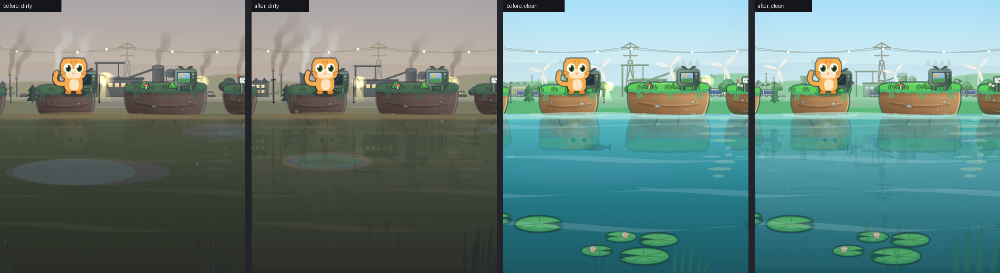
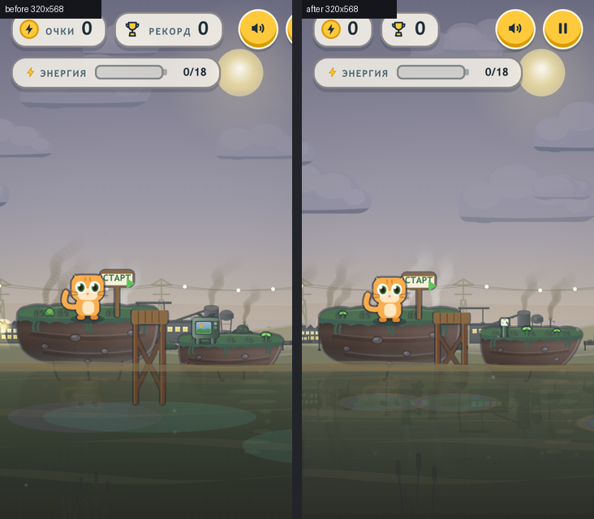
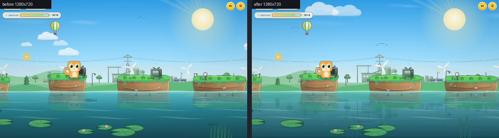

# Энергопрыжок v10.3 — Upright Phones & Graphics: Implementation Plan

> **For agentic workers:** REQUIRED SUB-SKILL: Use superpowers:subagent-driven-development (recommended) or superpowers:executing-plans to implement this plan task-by-task. Steps use checkbox (`- [ ]`) syntax for tracking.

**Goal:** The game should play well on a phone held upright. Turning the phone mid-run must never strand the hero. The scenery must stop jumping around on resize. The HUD must fit on the narrowest phones. The tall water band on an upright screen should come alive: it mirrors the far shore, the oil slicks become soft, the start pier sinks into the water like the islands, and the reeds frame the bottom corners.

**Architecture:** Everything changes in place in `clean-hop-v10/`, as the finished graphics update was. Code comments tag the new work `v10.3:`.
- **Turning the phone.** `layout()` learns what a resize changed. If the jump's reach changed, a new `rebuildCourse()` throws away the islands ahead and respawns them from the island the hero stands on, using the existing spawner, which already guarantees every gap is jumpable. The scenery is rebuilt only when the width changes.
- **Mirror.** The finished background band above the waterline is copied once per frame with `drawImage` into a scratch canvas, flipped, then laid under the waterline in swaying strips.
- **Water details.** Slicks, pier and reeds get small sizing helpers (`slickAt`, `reedU`, and `drawIslandBody` for the pier).

**Tech Stack:** Single-file `index.html` (ES5 inside a `'use strict'` IIFE, Canvas 2D), SVG sprites, a `sw.js` offline cache, and the Python and headless-Chrome tools in `tools/` (`check.py`, `run-scenario.py`, `scenarios.py`, `shots.py`, `look.py`, `cdp.mjs`, and the new `phones.py`).

**Spec:** This plan is its own spec. §1 says what is wrong today, §2 lists the decisions, and §3 says what v10.3 must do. Everything was measured on 2026-10-10 on the current working tree: commit `6241be2` (v10.1) plus the finished, uncommitted graphics update (soft island light, islands in the water, background ruler `SU`, balloon). A throwaway prototype of Tasks 1–4 lived in a scratch folder and produced the "after" images and numbers below. No repo file was changed.

---

## 1. What's wrong today (measured)

Screens tested upright: 320×568, 360×640, 375×667, 390×664 (iPhone 14 in Safari with its toolbars), 390×844, 412×915 and 430×932. Sideways and desktop for comparison: 844×390 and 1280×720.

| # | Problem | What happens | Measured (today) |
|---|---|---|---|
| P1 | **Turning the phone mid-run strands the hero** | Jump reach is `MIN_D..MAX_D = (0.2..0.6)·VW/Z`, but the islands already built keep the old screen's gaps. | Sideways → upright: **all 5** islands ahead are out of reach (gaps 263–294 px, max jump 187 px). Upright → sideways: the *shortest* hop (169 px) overshoots islands 112–121 px apart. |
| P2 | **A held jump survives the turn** | The press stays in `charge`; lifting the finger fires a jump with the new reach at the old course. | `phase` is still `charge` after the turn; the release jumps (`air`). |
| P3 | **The menu's islands keep the old spacing** | Behind the menu card the islands sit for the old screen. | 6 of 6 out of reach after 844×390 → 390×844. |
| P4 | **The scenery reshuffles on every resize** | `layout()` rebuilds clouds, factories, shore, reeds and motes with fresh random numbers. This also fires on a same-size resize, on a QUALITY drop to 0 mid-run (which calls `layout()`), and when a phone toolbar slides in. | Same-size resize: factory x `[11,102,174]` → `[-16,104,199]`. |
| P5 | **Pause button off screen on 320-px phones** | The HUD row is wider than the phone. | Pause at x 313–357 on a 320-px screen (36 px off); on 360 px it's 3–4 px from the edge. |
| P6 | **Oil slicks are flat plates** | Fixed-pixel ellipses (up to 105 px radius) were sized for landscape. | On 390×844 the biggest is **262 px wide (67 % of the screen)**, a pale disk with a dark rim. |
| P7 | **The upright water band is empty** | Water is 30 % of an upright screen. Below the islands' reflections it's a flat wash, especially when dirty. | 253 px of water at 390×844; water detail (luminance sd) 5.1 when dirty. |
| P8 | **The start pier stands solid in the water** | The jetty is drawn whole below the waterline, and its depth rides on `VH`. | Legs 52 px under water at 390×844 vs 24 px at 844×390. |
| P9 | **Reeds are tiny on upright phones** | Reed size is `min(VW, VH)·0.117`, which is the *width* on an upright phone. | 45 px × s at 390×844, next to a 253-px water band. |

What is already fine (checked, no change planned):
- The menu, pause and game-over cards fit at 320–430 px.
- `sizes.js` and `visual.js` pass at 320×568, 360×640 and 375×667.
- On touch screens the key hints switch to "Держи палец на экране".
- The safe-area insets are used by the HUD and the cards.

Upright phone 390×844, the water band. From left: dirty before, dirty after, clean before, clean after (prototype). The far shore, pylon and turbines are mirrored, and the slick is a soft rainbow ring instead of a plate:

<p></p>

Narrowest phone, 320×568, first seconds of a run (before | after). The pause button is back on screen, and the pier's legs end at the waterline. The islands differ because the start scene isn't seeded:

<p></p>

Landscape stays itself. 1280×720, clean (before | after). Only the faint mirror and the slicks change:

<p></p>

## 2. Decisions to confirm before Task 0

Answer with one sign per number, e.g. `0 + 1 + 2 + 3 + 4 + 5 + 6 +`.

| # | Decision | Recommended |
|---|---|---|
| 0 | **Commit the finished graphics update first** as `clean-hop v10.2` (it's done and passes `check.py`, but isn't committed). This plan's diff then stays reviewable on its own (Task 0). | **+** |
| 1 | **Turning the phone is safe.** A turn rebuilds the islands ahead for the new screen. A held jump is let go. Mid-air, the rebuild waits for the landing. The menu's islands are rebuilt too. The scenery is rebuilt only when the width changes (Task 1). This is the one gameplay-code change. | **+** |
| 2 | **HUD on narrow phones.** Under 375 px wide, the score and record pills drop their words and keep the coin, trophy and numbers, so the pause button stays on screen (Task 2). | **+** |
| 3 | **The water mirrors the far shore.** Hills, factories, pylons and turbines show upside down in the water, rippling and fading with depth. Clearer water gives a clearer mirror. It's off on the slowest QUALITY tier (Task 3). | **+** |
| 4 | **Soft oil slicks.** Rainbow-edged soft slicks no wider than an island replace the flat plates. They fade to a trace in clean water (Task 4 A). | **+** |
| 5 | **The pier sinks into the water** like the islands, with a depth by the hero's ruler on every screen (Task 4 B). | **+** |
| 6 | **Taller reeds on upright phones**, so the bottom corners are framed. Landscape keeps exactly today's reeds (Task 4 C). | **+** |

If a decision is **−**:
- **0 −** Skip Task 0 Step 1. Task 5's single commit then holds both updates; name it `clean-hop v10.2`.
- **1 −** Skip Task 1 Steps 2–8, but still do Step 1 (`phones.py`, which Task 2 needs). Delete the `rotate.js` line in Task 5.
- **2 −** Skip Task 2. Delete the `hudfit.js` line in Task 5.
- **3 −** In Task 3 do only Steps 3–4 (the `look.py` tooling, which Task 5 needs). Delete the `mirror.js` lines in Task 5.
- **4 / 5 / 6 −** In Task 4 skip part A / B / C and the matching test lines (the `slicks`, `jetty` or `reeds` checks).

## 3. What v10.3 must do (spec)

### 3.1 Turning the phone (Task 1)
- `layout()` remembers `VW` and `MAX_D` from before the resize.
- **Scenery:** `buildClouds`, `buildFactories`, `buildForeground`, `buildMotes` and `buildShore` run only when `VW` changed (the first `layout()` call always runs them). A height-only change (a toolbar, a QUALITY drop) keeps every factory, shore object and cloud where it is.
- **Course:** when `MAX_D` changed by more than 1 %, `courseChanged()` runs:
  - **menu:** `reset(); menuWorld();` (fresh islands for the new screen).
  - **play, not won:** a held jump is cancelled (`cancelPress()`), so the release fires nothing. The course is marked stale.
  - **standing:** `rebuildCourse()` runs now.
  - **mid-air:** it runs on the first update after the landing (`phase === 'stand'`).
  - **over, or won:** nothing.
- `rebuildCourse()` keeps the island under the hero and everything behind it. It drops the islands and sparks ahead, then sets `lastX/lastTop/lastW` from the hero's island and refills with `spawnStone()` up to `camX + VW·1.9`.
  - A finish meadow ahead is dropped and respawned by the spawner, so there's exactly one, at a reachable gap.
  - `finishCued` stays set, so «ФИНИШ ВПЕРЕДИ!» doesn't pop up again.
  - If the power-strip hint's island was dropped, the hint is cleared, so the next strip gets it.
- `reset()` clears the stale mark.
- **Pass rule:** after any turn, every island ahead has a landing spot inside `MIN_D..MAX_D` (`gap − w/2 ≤ MAX_D` and `gap + w/2 ≥ MIN_D`) at all 12 `phones.py` screens.

### 3.2 HUD on narrow phones (Task 2)
- `@media (max-width:374px){ .pill .lbl{display:none} }`. Nothing else in the HUD changes.
- **Pass rule:** at every `phones.py` screen, every pill and button is at least 6 px inside both edges, and no two overlap. The words show exactly when the width is ≥ 375 px and the screen isn't a narrow sideways phone (the existing `max-height:500px and max-width:720px` rule).

### 3.3 The mirror (Task 3)
- **`grabHorizon()`** runs right after `drawShore()` (the background is complete, the hero plane hasn't drawn yet).
  - Band height `mirH = round(min(groundY·0.45, (VH − groundY)·0.80))` CSS px. It's 0 (no mirror) when `QUALITY < 1` or when the band is under 12 px.
  - It copies the canvas rows `groundY − mirH … groundY`, flipped (the waterline row on top), into a scratch canvas at device resolution.
  - It tints the copy 50 % toward `P.sludgeHi → P.sludgeLo` with `source-atop`.
- **`drawHorizonMirror()`** runs right after `drawFish()`, inside the zoom block but in screen space (`setTransform(DPR,0,0,DPR,0,0)`).
  - It draws N strips (8 at QUALITY 2, 4 at QUALITY 1), each stretched ×1.2. Strip i sways by `sin(T·1.6 + i·0.9)·(0.5 + i·0.45)` px.
  - Alpha is `lerp(0.30, 0.55, cleanShown) × (1 − 0.8·i/N)`.
  - Island reflections, the submerged keels, pads, the tint and the surface all draw over it.
- **file:// safety:** game code never reads pixels from the main canvas; `drawImage` canvas→canvas only.
- **Expected bands:** 202 px at 390×844, 196 px at 1280×720, 136 px at 320×568.
- **Looks** (`look.py`, against the v10.2 baseline): island light, warmth and veil unchanged. Water detail ≥ 0.9× (the prototype raised it, e.g. 5.1 → 6.9 at 390×844 dirty). Water brightness ≤ baseline + 15 (prototype: +4 to +11).
- **Perf** (`look.py`, 390×844, CPU ×4, median of 3): ≤ baseline × 1.25 + 0.3 ms, QUALITY held. Prototype: 2.21 ms vs 1.82 ms baseline (medians of 5), QUALITY 2.

### 3.4 Water details (Task 4)
- **A. Slicks:** `slickAt(i)` (i = 0..4) returns `{ x, y, rx, a }`:
  - `y = groundY + U·(0.45 + (i%3)·0.5)` and `rx = U·(0.7 + (i%3)·0.2)` (so `rx ≤ 1.1 U`).
  - `a = 0.30·(1 − 0.8·cleanShown)`.
  - Drawn as a radial gradient squashed to 0.2 height: centre `#63d1c0` at a·0.45, `#63d1c0` a at 0.55, `#9d7be0` a at 0.75, `#ffd36b` a·0.6 at 0.9, transparent at the edge.
  - **Pass rule:** `2·rx·Z ≤ 0.32·VW` on every phone screen, and `a ≤ 0.07` when clean.
- **B. Pier:** depth `jh = (groundY − top) + U·0.5 + 8`, drawn through `drawIslandBody('jetty', …, 1, 0.5, 2)`, so its reflection still shows only at QUALITY 2. `check.py` forbids `spr('jetty'` and `VH * 0.062`.
- **C. Reeds:** `reedU() = clamp(max(min(VW, VH)·0.117, (VH − groundY)·0.30), 36, 99)`. On every screen with `VW ≥ VH` this equals today's `clamp(min(VW, VH)·0.117, 36, 99)` exactly, because `groundY ≥ 0.66·VH` there. Upright 390×844 goes 45.6 → 75.9.

### 3.5 Not in this plan
- **A fullscreen button.** Home Screen install already runs full screen (`display: standalone`). `requestFullscreen` doesn't exist on iPhone, and on Android it shows a "swipe to exit" bar.
- **Locking the orientation.** Mobile browsers allow it only in fullscreen or in installed apps, so both orientations are supported instead.
- **Screens narrower than 300 px** (Galaxy Fold cover, 280 px) **and sideways phones shorter than 380 px.** `layout()` floors `VW` at 300 and `VH` at 380, so a sliver is cut off. This is rare; it can be a separate fix.
- **The jump arc's height.** It rides on `VH`, so it's taller on an upright phone and uses the empty sky. It plays fine and is unchanged.
- **Hero art and faces.** Untouched; they stay friendly.
- **HUD style, menu and game-over cards.** They already fit at 320–430 px.

## Global Constraints

- Work in place in `clean-hop-v10/`. Leave older folders untouched. New code comments say `v10.3:`.
- Game code style: one `index.html`, ES5 (`var`, `function`, no arrow functions) inside the `'use strict'` IIFE. It must work when double-clicked (`file://`), so game code never reads pixels of the main canvas; the mirror uses `drawImage` only. Scenario files in `tools/scenarios/` may use modern JS, as the existing ones do.
- `python3 tools/check.py` must print `OK` at the end of every task.
- `sw.js` `VERSION` starts at `'clean-hop-v10-6'` and goes up by one at the end of each task that changes game files: Task 1 `-7`, Task 2 `-8`, Task 3 `-9`, Task 4 `-10`.
- The only gameplay change is §3.1: islands ahead are rebuilt after a resize that changes the jump's reach. Physics, jump feel, island spacing rules, camera, `Z`, `B` and `groundY` are untouched.
- Landscape and desktop keep today's HUD, reeds and scenery layout. Only the mirror and the slicks change there.
- Performance (§3.3): `look.py --only perf` passes, and the QUALITY tier never drops.
- Don't commit until the user says so. Decision 0 **+** is that permission for the `v10.2` commit only. The final commit is `clean-hop v10.3` (Task 5).

## Review Focus

1. **The phone turns while the finish meadow is already ahead.** There must still be exactly one meadow ahead, reachable, and «ФИНИШ ВПЕРЕДИ!» must not pop up again. Pinned by `rotate.js` check `finish` (Task 1).
2. **The phone turns mid-air.** The island being flown to must stay; the rebuild happens after the landing, and the islands after it must be reachable. Pinned by `rotate.js` check `air` (Task 1).
3. **The phone turns while the jump is held**, including the 10-second secret hold. The press is let go, and lifting the finger afterwards must not jump. Pinned by `rotate.js` check `charge` (Task 1).
4. **Slow phones.** No mirror at QUALITY 0 (and nothing throws), 4 strips at QUALITY 1, no tier drop at 390×844 CPU ×4. Pinned by `mirror.js` check `lean` and `look.py --only perf` (Task 3).
5. **Opened by double-click (`file://`).** The mirror copies a canvas that has file:// sprites drawn on it. `drawImage` is allowed there, and reading pixels would not be. Pinned by `mirror.js --no-inline` (Task 3).

## File map

| File | Task | Change |
|---|---|---|
| `tools/cdp.mjs` | 0 | `fresh` job option: start each page from an empty `localStorage` |
| `tools/shots.py` | 0 | `fresh` shots, a 320×568 row, `--game` may be an absolute path |
| `tools/phones.py` | 1 | Create: run one scenario at 12 phone/desktop screens |
| `tools/scenarios/rotate.js` | 1 | Create |
| `clean-hop-v10/index.html` | 1–4 | `layout()`, `courseChanged`, `rebuildCourse`, `reset()`, `update()`; HUD CSS; `grabHorizon`, `drawHorizonMirror`, `render()`; `slickAt`, `drawSludge`, `drawStartExtras`, `reedU`, `drawForeground` |
| `clean-hop-v10/sw.js` | 1–4 | `VERSION` bumps |
| `tools/scenarios/hudfit.js` | 2 | Create |
| `tools/test-build.py` | 3, 4 | Hooks: `mirH`, `slickAt`, `reedU` |
| `tools/scenarios/mirror.js` | 3 | Create |
| `tools/look.py` | 3 | `--old <game>`, water-brightness rule, perf as a median of 3 |
| `tools/scenarios/water-bits.js` | 4 | Create |
| `tools/check.py` | 4 | Jetty guard |

Line numbers below are from the current working tree (2026-10-10). They shift as tasks add code, so search for the quoted text.

---

### Task 0: Commit v10.2, take the baseline, and fix the screenshot tooling

**Files:**
- Modify: `tools/cdp.mjs:36-42` (job loop) and its header comment
- Modify: `tools/shots.py:17,24-30,33-34,44-49`

**Interfaces:**
- Produces:
  - the baseline copy `$TMPDIR/ch-base`, used as `look.py --old` (Task 3) and as `shots.py --tag before`
  - `$TMPDIR/v10.2-scenarios.txt` (Task 5)
  - the job option `"fresh": true` in `cdp.mjs`

- [ ] **Step 1: Commit the graphics update (Decision 0 +)**

Run from the project root (`~/Projects/milana/clean-hop`):
```bash
python3 tools/check.py
for s in 1280x720 844x390 1024x768 390x844 320x640 768x1024; do python3 tools/run-scenario.py tools/scenarios/bg-scale.js --size $s; done
python3 tools/run-scenario.py tools/scenarios/balloon.js --url shot=1,7
```
Expected: `OK`, six `"pass": true`, then `"pass": true`.
```bash
git add clean-hop-v10 tools
git commit -m "clean-hop v10.2" -m "Graphics update: soft island light, islands sit in the water, background ruler SU for upright phones, hot-air balloon." -m "Co-Authored-By: Claude Opus 5.5 <noreply@anthropic.com>"
```

- [ ] **Step 2: Snapshot the baseline**

```bash
rm -rf "$TMPDIR/ch-base" && cp -R clean-hop-v10 "$TMPDIR/ch-base"
```

- [ ] **Step 3: A fresh save for every screenshot**

Found while planning: all jobs of one `chrome.run()` share one profile, and every `file://` page shares one `localStorage`. A long `shots.py` run therefore plays its tenth game, and the «Юбилей» egg's «✨ Секрет найден!» toast lands in the later screenshots.

In `tools/cdp.mjs`, after `    await send('Runtime.enable', {}, sessionId);` add:
```js
    /* fresh: start from an empty save - every file:// page shares one
       localStorage, so a long shot run would play its tenth game and an
       egg's «Секрет найден!» toast would land in the later screenshots */
    if (job.fresh)
      await send('Page.addScriptToEvaluateOnNewDocument',
        { source: 'try { localStorage.clear(); } catch (e) {}' }, sessionId);
```
In the header comment, after the `"type": "eval"` job example, add the line:
```
     Any job may add "fresh": true - the page starts with an empty localStorage.
```

Prove it:
```bash
python3 - <<'EOF'
import sys, pathlib, tempfile
sys.path.insert(0, 'tools')
import chrome
p = pathlib.Path(tempfile.gettempdir()) / 'ch-fresh.html'
p.write_text('<body data-ready="1">')
u = 'file://' + str(p)
r = chrome.run([{'type': 'eval', 'id': 'set', 'url': u, 'expr': "localStorage.setItem('k', '1'), 1"},
                {'type': 'eval', 'id': 'kept', 'url': u, 'expr': "localStorage.getItem('k')"},
                {'type': 'eval', 'id': 'fresh', 'url': u, 'expr': "localStorage.getItem('k')", 'fresh': True}])
print([x.get('result') for x in r])
EOF
```
Expected: `[1, '1', None]`.

- [ ] **Step 4: `shots.py` uses it, gains a 320×568 row, and takes a path**

In `tools/shots.py`:
- change `VIEWPORTS = [(390, 844), (844, 390), (1280, 720)]` to:
```python
VIEWPORTS = [(390, 844), (320, 568), (844, 390), (1280, 720)]
```
- change the `--game` help to `'game folder under the project root, or an absolute path'`
- change `tag = args.tag or args.game` to:
```python
tag = args.tag or pathlib.Path(args.game).name
```
- change `test_dir = pathlib.Path(tempfile.gettempdir()) / ('clean-hop-test-' + args.game)` to:
```python
test_dir = pathlib.Path(tempfile.gettempdir()) / ('clean-hop-test-' + pathlib.Path(args.game).name)
```
- in the job dict, after `'cpu': args.cpu or 0, 'ready': ready,` add `'fresh': True,`.

- [ ] **Step 5: Record the baselines**

```bash
python3 tools/scenarios.py > "$TMPDIR/v10.2-scenarios.txt"
python3 tools/shots.py --game "$TMPDIR/ch-base" --tag before
```
Expected: the txt has one `<name> pass|FAIL|-` line per scenario (56). It already contains `intro FAIL` and `egg-penguin FAIL` (see Task 5 Step 2). `shots.py` prints 12 PNG paths and `contact.html`. Open `contact.html`: no screenshot shows the yellow «Секрет найден!» toast.

---

### Task 1: Turning the phone is safe (Decision 1)

**Files:**
- Create: `tools/phones.py`, `tools/scenarios/rotate.js`
- Modify: `clean-hop-v10/index.html`:
  - `layout()` (2431–2481)
  - new functions after `layout()`
  - `reset()` (3067)
  - `update()` (4930)
- Modify: `clean-hop-v10/sw.js:4`

**Interfaces:**
- Consumes: the existing `spawnStone()`, `reset()`, `menuWorld()`, `cancelPress()`, and the globals `stones`, `items`, `hop`, `lastX/lastTop/lastW/lastWasCrumble`, `finishStone/finishSpawned`, `stripHint/stripHintSeen`, `MAX_D`, `phase`, `mode`, `won`.
- Produces:
  - `courseChanged()` and `rebuildCourse()` (both return nothing)
  - the global `courseStale` (boolean)
  - `tools/phones.py <scenario.js> [run-scenario args]`, which exits 1 if any screen fails (Tasks 2 and 4 use it)

- [ ] **Step 1: Write the screen runner**

Create `tools/phones.py`:
```python
#!/usr/bin/env python3
"""Run one tools/scenarios/*.js file at every phone screen, upright and
sideways, plus a tablet and a desktop; one line per screen:
    python3 tools/phones.py rotate.js
    python3 tools/phones.py hudfit.js --game clean-hop-v9
390x664 is an iPhone 14 in Safari with its toolbars showing.
Exits 1 when any screen fails or gives no result."""
import json, pathlib, subprocess, sys

ROOT = pathlib.Path(__file__).resolve().parent.parent
PHONES = [(320, 568), (360, 640), (375, 667), (390, 664), (390, 844),
          (412, 915), (430, 932), (568, 320), (844, 390), (932, 430),
          (768, 1024), (1280, 720)]

scenario = ROOT / 'tools/scenarios' / sys.argv[1]
extra = sys.argv[2:]
bad = 0
for w, h in PHONES:
    r = subprocess.run([sys.executable, str(ROOT / 'tools/run-scenario.py'),
                        str(scenario), '--size', '%dx%d' % (w, h)] + extra,
                       capture_output=True, text=True, timeout=240)
    res = None
    for line in r.stdout.splitlines():
        line = line.strip()
        if line.startswith('{'):
            try:
                res = json.loads(line)
            except ValueError:
                pass
    ok = bool(res and res.get('pass'))
    bad += not ok
    why = '; '.join(res.get('fails') or []) if res else \
        (r.stdout + r.stderr).strip()[-200:]
    print('%4dx%-4d %s  %s' % (w, h, 'pass' if ok else 'FAIL', why), flush=True)
sys.exit(1 if bad else 0)
```

- [ ] **Step 2: Write the failing scenario**

Create `tools/scenarios/rotate.js`:
```js
// v10.3 turning the phone mid-run (plan §3.1). Every screen:
//   python3 tools/phones.py rotate.js
// Headless Chrome can't rotate, so turn() swaps innerWidth/innerHeight and
// fires 'resize' - layout() reads nothing else.
// menu     the menu's islands are rebuilt for the new screen
// scenery  a resize to the same width keeps the factories and the shore
// standing every island ahead has a landing spot inside MIN_D..MAX_D
// charge   a held jump is let go by the turn; the release fires nothing
// air      a turn mid-air rebuilds the course right after the landing
// finish   with the bar full the meadow is still ahead, once, reachable,
//          and «ФИНИШ ВПЕРЕДИ!» does not pop up a second time
const t = __t, wait = ms => new Promise(r => setTimeout(r, ms));
const W0 = innerWidth, H0 = innerHeight;
const turn = (w, h) => {
  Object.defineProperty(window, 'innerWidth', { value: w, configurable: true });
  Object.defineProperty(window, 'innerHeight', { value: h, configurable: true });
  window.dispatchEvent(new Event('resize'));
};
const ahead = () => t.stones.filter(s => s !== t.hop.onStone && s.ax > t.hop.x)
                            .sort((a, b) => a.ax - b.ax);
function unreachable() {           // gaps with no landing spot in MIN_D..MAX_D
  let x = t.hop.x; const bad = [];
  for (const s of ahead()) {
    const g = s.ax - x, half = s.w / 2;
    if (g - half > t.MAX_D || g + half < t.MIN_D) bad.push(Math.round(g));
    x = s.ax;
  }
  return bad;
}
const nextIsland = () => ahead().filter(s => !s.visited && s.type !== 'finish')[0];
async function hopOn(n) {
  for (let i = 0; i < n && t.mode === 'play'; i++) {
    const s = nextIsland(); if (!s) break;
    t.hop.x = s.x; t.land(s, t.stoneTop(s)); await wait(250);
  }
}
const cv = document.getElementById('game');
const down = () => cv.dispatchEvent(new PointerEvent('pointerdown',
  { bubbles: true, clientX: 100, clientY: 300, pointerId: 1 }));
const up = () => window.dispatchEvent(new PointerEvent('pointerup', { pointerId: 1 }));
const scenery = () => JSON.stringify([t.shore.slice(0, 4).map(o => Math.round(o.x)),
                                      t.factories.slice(0, 4).map(f => Math.round(f.x))]);
const fails = [], out = { vw: W0, vh: H0 };
const check = (name, bad) => { out[name] = bad; if (bad.length) fails.push(name + ': ' + bad); };

for (let i = 0; i < 60 && !t.spritesReady; i++) await wait(100);
turn(H0, W0); await wait(150);
check('menu', unreachable());
turn(W0, H0); await wait(150);

const sc = scenery();
window.dispatchEvent(new Event('resize')); await wait(100);
if (scenery() !== sc) fails.push('scenery: a same-size resize reshuffled it');

document.getElementById('playBtn').click();
await wait(1800);
await hopOn(3);
turn(H0, W0); await wait(200);
check('standing', unreachable());
turn(W0, H0); await wait(200);
check('back', unreachable());

down(); await wait(200);
turn(H0, W0); await wait(200);
if (t.phase !== 'stand') fails.push('charge: the turn did not let go (' + t.phase + ')');
up(); await wait(100);
if (t.phase !== 'stand') fails.push('charge: the release after the turn jumped (' + t.phase + ')');
check('charge', unreachable());
turn(W0, H0); await wait(200);

down(); await wait(250); up(); await wait(60);
out.airPhase = t.phase;
turn(H0, W0); await wait(50);
const s = nextIsland();
t.hop.x = s.x; t.land(s, t.stoneTop(s)); await wait(300);
check('air', unreachable());
turn(W0, H0); await wait(200);

t.energy = 999;                                   // the bar is full: the meadow comes
for (let i = 0; i < 12 && t.mode === 'play' && !ahead().some(s => s.type === 'finish'); i++)
  await hopOn(1);
const cheer = p => p.t === 'ФИНИШ ВПЕРЕДИ!';
for (let i = 0; i < 30 && !t.pops.some(cheer); i++) await wait(100);   // cued once
await wait(400);
turn(H0, W0); await wait(150);
const again = t.pops.filter(p => cheer(p) && p.max - p.life < 0.3).length;
const meadows = ahead().filter(s => s.type === 'finish').length;
if (meadows !== 1) fails.push('finish: ' + meadows + ' meadows ahead after the turn');
check('finish', unreachable());
if (again) fails.push('finish: «ФИНИШ ВПЕРЕДИ!» popped up again');
({ ...out, fails, pass: fails.length === 0 })
```

- [ ] **Step 3: Run it to make sure it fails**

Run: `python3 tools/phones.py rotate.js`
Expected: exit 1, every screen `FAIL`. Each line includes `scenery: a same-size resize reshuffled it` and `charge: the turn did not let go (charge)`. Most also include `standing: …` and `air: …`. On 844×390 the planning run gave `menu: 263,265,286,270,263,263` and `standing: 277,263,271,293,294`.

- [ ] **Step 4: `layout()` remembers what changed**

In `clean-hop-v10/index.html`, change:
```js
function layout() {
  var prevGround = groundY, prevDPR = DPR;
```
to:
```js
function layout() {
  var prevGround = groundY, prevDPR = DPR;
  var prevVW = VW, prevMaxD = MAX_D;               // v10.3: what did this resize change?
```
and change the end of `layout()`:
```js
    lastTop += dy;
  }
  buildClouds();
  buildFactories();
  buildForeground();
  buildMotes();
  buildShore();
  measureScorePill();
  paintPortraits();
}
```
to:
```js
    lastTop += dy;
  }
  /* v10.3: the scenery is laid out across the width - rebuild it only when
     the width changed. A QUALITY drop, a repeated resize event or a phone
     toolbar sliding in must not reshuffle the factories mid-run */
  if (VW !== prevVW) {
    buildClouds();
    buildFactories();
    buildForeground();
    buildMotes();
    buildShore();
  }
  measureScorePill();
  paintPortraits();
  if (prevMaxD && Math.abs(MAX_D / prevMaxD - 1) > 0.01) courseChanged();
}

/** v10.3: the screen turned mid-run. The jump's reach (MIN_D..MAX_D) and
    the island sizes ride on the screen, so the islands built ahead were
    made for the old one: out of reach after a turn to upright, overshot
    after a turn to sideways. Rebuild them from the island the hero stands
    on - mid-air, as soon as it lands. */
var courseStale = false;
function courseChanged() {
  if (mode === 'menu') { reset(); menuWorld(); return; }
  if (mode !== 'play' || won) return;
  if (phase === 'charge') cancelPress();           // the release must not jump
  courseStale = true;
  if (phase === 'stand') rebuildCourse();
}
function rebuildCourse() {
  courseStale = false;
  var cur = hop.onStone;
  if (!cur || cur.type === 'finish') return;
  var keep = [];
  for (var i = 0; i < stones.length; i++)
    if (stones[i] === cur || stones[i].ax < cur.ax) keep.push(stones[i]);
  stones = keep;
  var ki = [];
  for (var j = 0; j < items.length; j++) if (items[j].x < cur.ax) ki.push(items[j]);
  items = ki;
  if (finishStone && finishStone !== cur) {
    finishStone = null; finishSpawned = false;   // finishCued stays: no second cheer
  }
  if (stripHint && stones.indexOf(stripHint.s) < 0) {   // its strip is gone:
    stripHint = null; stripHintSeen = false;            // hint the next one instead
  }
  lastX = cur.ax; lastTop = cur.baseY; lastW = cur.w; lastWasCrumble = false;
  while (!finishSpawned && lastX < camX + VW * 1.9) spawnStone();
}
```
(`reset()` may call `layout()` while QUALITY is not 2. By then `MAX_D` is unchanged, so `courseChanged()` doesn't run again: no recursion.)

- [ ] **Step 5: Rebuild after the landing, and forget it on a new run**

In `update()`, change:
```js
    while (!finishSpawned && lastX < camX + VW * 1.9) spawnStone();
```
to:
```js
    if (courseStale && phase === 'stand') rebuildCourse();   // v10.3: landed after a turn
    while (!finishSpawned && lastX < camX + VW * 1.9) spawnStone();
```
In `reset()`, change `  ripples.length = 0; pops.length = 0;` to:
```js
  ripples.length = 0; pops.length = 0;
  courseStale = false;                             // v10.3: a new run starts square
```

- [ ] **Step 6: Run it to make sure it passes**

Run: `python3 tools/phones.py rotate.js`
Expected: exit 0, all 12 screens `pass`. The prototype passed at 844×390, 390×844, 375×667 and 1280×720.

Run: `python3 tools/check.py`
Expected: `OK`

- [ ] **Step 7: Nothing else moved**

```bash
python3 tools/run-scenario.py tools/scenarios/visual.js --size 390x844
python3 tools/run-scenario.py tools/scenarios/world.js
python3 tools/run-scenario.py tools/scenarios/jump.js
python3 tools/run-scenario.py tools/scenarios/wiring.js
python3 tools/run-scenario.py tools/scenarios/factories.js
python3 tools/run-scenario.py tools/scenarios/lights.js
python3 tools/sizes.py
```
Expected: `"pass": true` six times, then exit 0. `sizes.py` is a little flaky even on v10: if it fails, run it once more before you investigate. (Don't use `intro.js` as a guard here: it already fails before this plan, see Task 5 Step 2.)

- [ ] **Step 8: Bump the cache version**

`clean-hop-v10/sw.js`: `var VERSION = 'clean-hop-v10-7';`. Then run `python3 tools/check.py` and expect `OK`.

---

### Task 2: The HUD fits the narrowest phones (Decision 2)

**Files:**
- Create: `tools/scenarios/hudfit.js`
- Modify: `clean-hop-v10/index.html` CSS, just above `/* ---------------- overlays ---------------- */` (159)
- Modify: `clean-hop-v10/sw.js:4`

**Interfaces:**
- Consumes: `tools/phones.py` (Task 1 Step 1).
- Produces: nothing used later.

- [ ] **Step 1: Write the failing scenario**

Create `tools/scenarios/hudfit.js`:
```js
// v10.3 the HUD on every screen (plan §3.2):
//   python3 tools/phones.py hudfit.js
// edges  every pill and button sits at least 6 px inside both screen edges
// apart  no two HUD pieces overlap
// words  the pill words show exactly on screens 375 px and wider, except
//        a narrow sideways phone (the existing max-height:500/max-width:720 rule)
const t = __t, wait = ms => new Promise(r => setTimeout(r, ms));
for (let i = 0; i < 60 && !t.spritesReady; i++) await wait(100);
document.getElementById('playBtn').click();
await wait(800);
const hud = document.querySelector('.hud');
const els = [...hud.querySelectorAll('.pill, .meter-wrap, .iconbtn')].filter(e => e.offsetParent);
const rs = els.map(e => { const r = e.getBoundingClientRect();
  return { id: e.id || e.className.split(' ')[0], l: r.left, r: r.right, t: r.top, b: r.bottom }; });
const fails = [];
for (const r of rs)
  if (r.l < 6 || r.r > innerWidth - 6)
    fails.push(r.id + ' off the edge: ' + Math.round(r.l) + '..' + Math.round(r.r));
for (let i = 0; i < rs.length; i++) for (let j = i + 1; j < rs.length; j++) {
  const a = rs[i], b = rs[j];
  if (a.l < b.r && b.l < a.r && a.t < b.b && b.t < a.b) fails.push(a.id + ' overlaps ' + b.id);
}
const lbl = document.querySelector('.pill .lbl');
const words = !!(lbl && lbl.offsetParent);
const want = innerWidth >= 375 && !(innerHeight <= 500 && innerWidth <= 720);
if (words !== want) fails.push('pill words ' + (words ? 'shown' : 'hidden'));
({ vw: innerWidth, vh: innerHeight, words, pieces: rs.length,
   hudBottom: Math.round(Math.max(...rs.map(r => r.b))), fails, pass: fails.length === 0 })
```

- [ ] **Step 2: Run it to make sure it fails**

Run: `python3 tools/phones.py hudfit.js`
Expected: exit 1. `320x568 FAIL  pauseBtn off the edge: 313..357` and `360x640 FAIL  pauseBtn off the edge: 313..357`. Every other screen passes.

- [ ] **Step 3: Drop the words on narrow phones**

In `clean-hop-v10/index.html`, just above `/* ---------------- overlays ---------------- */`, insert:
```css
/* v10.3: a narrow upright phone (an iPhone SE 1st gen, small Androids)
   drops the pill words too - the coin and the trophy say it - so the
   pause button stays on screen */
@media (max-width:374px){
  .pill .lbl{display:none}
}

```

- [ ] **Step 4: Run it to make sure it passes**

Run: `python3 tools/phones.py hudfit.js`
Expected: exit 0, all 12 `pass`.

```bash
python3 tools/run-scenario.py tools/scenarios/hud.js
python3 tools/run-scenario.py tools/scenarios/hud.js --size 568x320
python3 tools/run-scenario.py tools/scenarios/cards.js --size 390x844
python3 tools/fits.py
python3 tools/check.py
```
Expected: `"pass": true` three times, exit 0, `OK`.

- [ ] **Step 5: Bump the cache version**

`clean-hop-v10/sw.js`: `var VERSION = 'clean-hop-v10-8';`. Then run `python3 tools/check.py` and expect `OK`.

---

### Task 3: The water mirrors the far shore (Decision 3)

**Files:**
- Modify: `tools/test-build.py` HOOK (after `  render: function () { render(); },`, line 82)
- Create: `tools/scenarios/mirror.js`
- Modify: `tools/look.py` (`OLD`/`NEW`, docstring, water rules, perf block)
- Modify: `clean-hop-v10/index.html`:
  - new functions above `function drawSludgeTint() {` (6946)
  - `render()` (7295 and 7305)
- Modify: `clean-hop-v10/sw.js:4`

**Interfaces:**
- Consumes: the existing `canvas`, `ctx`, `DPR`, `VW`, `VH`, `groundY`, `QUALITY`, `P.sludgeHi/P.sludgeLo`, `cleanShown`, `T`, `lerp`.
- Produces:
  - `grabHorizon()` and `drawHorizonMirror()` (both return nothing)
  - the global `mirH` (CSS px of the copied band, 0 = no mirror this frame), exposed as `__t.mirH`
  - `look.py --old <game>` (Task 5 uses it)

- [ ] **Step 1: Expose `mirH` to the tests**

In `tools/test-build.py` HOOK, right after `  render: function () { render(); },`, add:
```js
  get mirH() { return __get(function () { return mirH; }); },     // v10.3: mirror.js
```

- [ ] **Step 2: Write the failing scenario**

Create `tools/scenarios/mirror.js`:
```js
// v10.3 the far shore mirrored in the water (plan §3.3, Review Focus 4-5).
// Needs a frozen scene:
//   python3 tools/run-scenario.py tools/scenarios/mirror.js --url shot=1,7 --size 390x844
//   python3 tools/run-scenario.py tools/scenarios/mirror.js --url shot=0,7 --no-inline
// band  the copied band is 12 px .. 80 % of the water band tall
// lean  at QUALITY 0 there is no mirror and nothing throws
// file  with --no-inline the sprites are real file:// images: the copy
//       still works (drawImage only - reading pixels would throw)
for (let i = 0; i < 200 && document.body.getAttribute('data-ready') !== '1'; i++)
  await new Promise(r => setTimeout(r, 50));
if (document.body.getAttribute('data-ready') !== '1')
  return { skipped: 'needs --url shot=<clean>,<seed>' };
const t = __t, fails = [];
const band = t.VH - t.groundY;
let err = null;
try { t.render(); } catch (e) { err = String(e); }
if (err) fails.push('render threw: ' + err);
const mh = t.mirH;
if (!(mh >= 12 && mh <= band * 0.8 + 0.5))
  fails.push('mirror band ' + mh + ' px for ' + Math.round(band) + ' px of water');
const q = t.quality;
err = null;
try { t.quality = 0; t.render(); } catch (e) { err = String(e); }
const lean = t.mirH;
t.quality = q; t.render();
if (err) fails.push('QUALITY 0 render threw: ' + err);
if (lean !== 0) fails.push('QUALITY 0 still mirrors ' + lean + ' px');
({ vw: t.VW, vh: t.VH, band: Math.round(band), mirH: mh, lean, fails, pass: fails.length === 0 })
```

Run:
```bash
python3 tools/run-scenario.py tools/scenarios/mirror.js --url shot=1,7 --size 390x844
```
Expected: `"pass": false` with `mirror band undefined px for 253 px of water`.

- [ ] **Step 3: `look.py` compares against any baseline, checks brightness, and steadies perf**

In `tools/look.py`:

Change the docstring's first lines and rules to:
```python
"""Look guard. Renders the same frozen #shot scene in an old and the new
game and checks the graphics goals with numbers:
    python3 tools/look.py                          # every rule, old = clean-hop-v9
    python3 tools/look.py --old "$TMPDIR/ch-base"  # against a saved baseline
    python3 tools/look.py --only island            # island | water | perf
Rules (new against old, same seed, same screen):
  island  light (right third - left third luminance) >= +3 at clean 0 and 1
  island  warmth (mean r-b of the soil) >= old - 5: the earth stays warm
  water   veil (soil just above the waterline minus soil under the lid)
          <= 0: no pale stripe where an island meets the water
  water   detail (luminance sd, lower water) >= 0.9x old: no regression
  water   brightness (mean luminance, lower water) <= old + 15: the
          v10.3 mirror must not wash the water out
  perf    render() ms at 390x844, CPU x4, median of 3 runs each:
          new <= 1.25x old + 0.3, QUALITY held
  seam and under print for information only.
Exits 1 when any rule fails."""
```
Change `OLD, NEW = 'clean-hop-v9', 'clean-hop-v10'` to:
```python
OLD = sys.argv[sys.argv.index('--old') + 1] if '--old' in sys.argv else 'clean-hop-v9'
NEW = 'clean-hop-v10'
```
After the `water detail` rule (`fails.append('%s: water detail %s (want >= %.1f)' % (` … `tag, bw['sd'], aw['sd'] * 0.9))`), add inside the same `if only in (None, 'water'):` block:
```python
                if bw['lum'] > aw['lum'] + 15:
                    fails.append('%s: water washed out %s (want <= %.1f)' % (
                        tag, bw['lum'], aw['lum'] + 15))
```
Replace the whole `if only in (None, 'perf'):` block with:
```python
def perf(game):
    """median of three runs - one headless run swings by +-50 %"""
    rs = [run('perf.js', game, '--size', '390x844', '--cpu', '4') for _ in range(3)]
    return {'renderMs': sorted(r['renderMs'] for r in rs)[1],
            'quality': min(r['quality'] for r in rs)}


if only in (None, 'perf'):
    a, b = perf(OLD), perf(NEW)
    print('perf 390x844 cpu4 (median of 3): old %s ms (q%s)  new %s ms (q%s)' % (
        a['renderMs'], a['quality'], b['renderMs'], b['quality']))
    if b['quality'] < a['quality']:
        fails.append('perf: new dropped to QUALITY %s (old held %s)' % (b['quality'], a['quality']))
    if b['renderMs'] > a['renderMs'] * 1.25 + 0.3:
        fails.append('perf: render %s ms (want <= %.2f)' % (b['renderMs'], a['renderMs'] * 1.25 + 0.3))
```

Run: `python3 tools/look.py --old "$TMPDIR/ch-base" --only water`
Expected: `PASS`. The game has no mirror yet, so it measures about the same as the baseline.

- [ ] **Step 4: Add the mirror**

In `clean-hop-v10/index.html`, just above `function drawSludgeTint() {`, insert:
```js
/* v10.3: the far shore mirrored in the water. grabHorizon() copies the
   finished background band just above the waterline (screen space, before
   the hero plane zooms) upside down into a scratch canvas, tinted toward
   the water; drawHorizonMirror() lays it under the line in swaying strips
   that fade with depth. drawImage only - game code never reads pixels,
   so a double-clicked (file://) game keeps working. */
var _mirCan = null, mirH = 0;
function grabHorizon() {
  mirH = 0;
  if (QUALITY < 1) return;                         // the leanest tier sheds it
  var mh = Math.round(Math.min(groundY * 0.45, (VH - groundY) * 0.80));
  if (mh < 12) return;
  var cw = canvas.width, ch = Math.round(mh * DPR);
  if (!_mirCan) _mirCan = document.createElement('canvas');
  if (_mirCan.width !== cw) _mirCan.width = cw;
  if (_mirCan.height !== ch) _mirCan.height = ch;
  var mg = _mirCan.getContext('2d');
  mg.setTransform(1, 0, 0, -1, 0, ch);             // flipped: row 0 = the waterline
  mg.globalCompositeOperation = 'copy';
  mg.globalAlpha = 1;
  mg.drawImage(canvas, 0, Math.round((groundY - mh) * DPR), cw, ch, 0, 0, cw, ch);
  mg.setTransform(1, 0, 0, 1, 0, 0);
  mg.globalCompositeOperation = 'source-atop';     // sink it into the water colour
  mg.globalAlpha = 0.5;
  var tg = mg.createLinearGradient(0, 0, 0, ch);
  tg.addColorStop(0, P.sludgeHi);
  tg.addColorStop(1, P.sludgeLo);
  mg.fillStyle = tg;
  mg.fillRect(0, 0, cw, ch);
  mg.globalCompositeOperation = 'source-over';
  mg.globalAlpha = 1;
  mirH = mh;
}
function drawHorizonMirror() {
  if (!mirH) return;
  ctx.save();
  ctx.setTransform(DPR, 0, 0, DPR, 0, 0);          // screen space, like the background
  var N = QUALITY >= 2 ? 8 : 4, sh = mirH / N, grow = 1.2;
  var a = lerp(0.30, 0.55, cleanShown);            // clearer water, clearer mirror
  for (var i = 0; i < N; i++) {
    var dy = groundY + 1 + i * sh * grow;
    if (dy > VH) break;
    ctx.globalAlpha = a * (1 - (i / N) * 0.8);
    ctx.drawImage(_mirCan, 0, i * sh * DPR, _mirCan.width, sh * DPR,
                  Math.sin(T * 1.6 + i * 0.9) * (0.5 + i * 0.45), dy, VW, sh * grow + 0.6);
  }
  ctx.restore();
}

```
In `render()`, change:
```js
  drawShore();

  /* the hero plane zooms around the waterline: Z scales the world between
```
to:
```js
  drawShore();
  grabHorizon();              // v10.3: the far shore, before the hero plane draws

  /* the hero plane zooms around the waterline: Z scales the world between
```
and change:
```js
  drawFish();                 // v10: under the surface, beneath the reflections
```
to:
```js
  drawFish();                 // v10: under the surface, beneath the reflections
  drawHorizonMirror();        // v10.3: the far shore upside down in the water
```

- [ ] **Step 5: Run it to make sure it passes**

```bash
python3 tools/run-scenario.py tools/scenarios/mirror.js --url shot=1,7 --size 390x844
python3 tools/run-scenario.py tools/scenarios/mirror.js --url shot=0,7 --size 320x568
python3 tools/run-scenario.py tools/scenarios/mirror.js --url shot=1,7 --size 1280x720
python3 tools/run-scenario.py tools/scenarios/mirror.js --url shot=0,7 --size 390x844 --no-inline
```
Expected: four `"pass": true`, with `mirH` 202, 136, 196, 202 and `lean` 0.

- [ ] **Step 6: The look rules and the slow phone**

Run: `python3 tools/look.py --old "$TMPDIR/ch-base"`
Expected: `PASS`. The prototype measured:
- island light, warmth, veil and seam unchanged
- water sd 5.2→7.7 (1280×720 dirty), 5.1→6.9 (390×844 dirty), 17.3→18.2 (390×844 clean)
- water brightness +4.2 to +10.8
- perf 2.21 vs 1.82 ms (medians), QUALITY 2

Run: `python3 tools/check.py`
Expected: `OK`

- [ ] **Step 7: Look at it**

Run: `python3 tools/shots.py`, then open the printed `contact.html`.

Expected in every row:
- Under the waterline the hills, factories, pylons and (when clean) turbines show upside down, rippled and fading downward, under the islands' own reflections.
- In dirty water the mirror is murky and faint; in clean water it's clearer.
- The 390×844 and 320×568 rows have no empty flat band any more.

Then open `clean-hop-v10/index.html` (double-click) and play one run. The mirror should move with the camera without lagging behind the shore. Open the menu's secret night (tap the sun on the menu): the night sky and the moon line show in the water too.

- [ ] **Step 8: Bump the cache version**

`clean-hop-v10/sw.js`: `var VERSION = 'clean-hop-v10-9';`. Then run `python3 tools/check.py` and expect `OK`.

---

### Task 4: Soft slicks, a sunken pier and taller reeds (Decisions 4, 5, 6)

**Files:**
- Modify: `tools/test-build.py` HOOK (after Task 3's `get mirH()` line)
- Create: `tools/scenarios/water-bits.js`
- Modify: `tools/check.py` (after the `drawIslandBody` guard, before the final `print`)
- Modify: `clean-hop-v10/index.html`:
  - `drawSludge` oily-sheen block (5693–5701), plus `slickAt` above `function drawSludge() {`
  - `drawStartExtras` (5966–5972)
  - `drawForeground` (5556), plus `reedU` above `function drawForeground() {`
- Modify: `clean-hop-v10/sw.js:4`

**Interfaces:**
- Consumes: `drawIslandBody(name, x, y, w, h, clean, reflMax, reflQ)` (from the v10.2 graphics update), `U`, `Z`, `camX`, `T`, `cleanShown`, `groundY`, `colA(hex, a)`, `clamp`.
- Produces: `slickAt(i)` → `{ x, y, rx, a }` (world units inside the zoom block; `a` is the slick's strength) and `reedU()` → number (CSS px before the per-reed scale `f.s`). Both are exposed on `__t`.

- [ ] **Step 1: Expose the helpers to the tests**

In `tools/test-build.py` HOOK, after `  get mirH() { … },`, add:
```js
  slickAt: function (i) { return __get(function () { return slickAt(i); }); },  // v10.3: water-bits.js
  reedU: function () { return __get(function () { return reedU(); }); },
```

- [ ] **Step 2: Write the failing scenario and guard**

Create `tools/scenarios/water-bits.js`:
```js
// v10.3 water details (plan §3.4):
//   python3 tools/phones.py water-bits.js
// slicks  every oily slick is at most 1.1 U in x-radius and at most 32 %
//         of the screen wide; only a trace (<= 0.07) once the water is clean
// reeds   every screen with VW >= VH keeps exactly the v10 reed size;
//         upright screens grow them with the water band (>= 0.30 of it, max 99)
const t = __t, wait = ms => new Promise(r => setTimeout(r, ms));
for (let i = 0; i < 60 && !t.spritesReady; i++) await wait(100);
document.getElementById('playBtn').click();
await wait(600);
const fails = [], out = { vw: t.VW, vh: t.VH, slicks: [] };
for (let i = 0; i < 5; i++) {
  const s = t.slickAt(i);
  if (!s) { fails.push('slicks: slickAt is missing'); break; }
  const share = 2 * s.rx * t.Z / t.VW;
  out.slicks.push(Math.round(share * 100));
  if (s.rx > t.U * 1.1 + 0.01) fails.push('slicks: ' + i + ' rx ' + s.rx.toFixed(1) + ' > 1.1 U');
  if (share > 0.32) fails.push('slicks: ' + i + ' is ' + Math.round(share * 100) + '% of the screen');
}
const keep = t.cleanShown;
t.cleanShown = 1;
const sc = t.slickAt(0);
if (sc && sc.a > 0.07) fails.push('slicks: still ' + sc.a.toFixed(2) + ' strong in clean water');
t.cleanShown = keep;
const r = t.reedU();
out.reed = typeof r === 'number' ? Math.round(r * 10) / 10 : r;
const v10 = Math.min(Math.max(Math.min(t.VW, t.VH) * 0.117, 36), 99);
if (typeof r !== 'number') fails.push('reeds: reedU is missing');
else if (t.VW >= t.VH) { if (Math.abs(r - v10) > 0.01) fails.push('reeds: landscape changed ' + v10.toFixed(1) + ' -> ' + r.toFixed(1)); }
else if (r < Math.min(99, (t.VH - t.groundY) * 0.30) - 0.01) fails.push('reeds: upright still small ' + r.toFixed(1));
({ ...out, fails, pass: fails.length === 0 })
```
In `tools/check.py`, below the `drawIslandBody` guard (after `problems.append('drawIslandBody must serve both drawStone and drawMeadow')`), add:
```python
# v10.3: the start jetty meets the water like the islands, at a depth by
# the hero's ruler - never drawn whole, never sized by the screen height
if VER >= 10:
    if re.search(r"\bspr\('jetty'", html) or 'VH * 0.062' in html:
        problems.append('jetty drawn whole or sized by VH, not via drawIslandBody')
```

Run: `python3 tools/phones.py water-bits.js`
Expected: exit 1, every screen `FAIL  slicks: slickAt is missing; reeds: reedU is missing`.

Run: `python3 tools/check.py`
Expected: exit 1 with `jetty drawn whole or sized by VH, not via drawIslandBody`.

- [ ] **Step 3: A. Soft slicks**

In `clean-hop-v10/index.html`, just above `function drawSludge() {`, insert:
```js
/** v10.3: oily slick i (0..4) this frame - world centre, x-radius and
    strength. Sized by the hero ruler U: an upright phone got flat plates
    two thirds of the screen wide. Only a trace stays once the water is clean. */
function slickAt(i) {
  var x = ((i * 233 - camX * 0.5) % (VW + 300) + VW + 300) % (VW + 300) - 150;
  return { x: x + Math.sin(T * 0.6 + i) * U * 0.25,
           y: groundY + U * (0.45 + (i % 3) * 0.5),
           rx: U * (0.7 + (i % 3) * 0.2),
           a: 0.30 * (1 - cleanShown * 0.8) };
}

```
In `drawSludge`, replace:
```js
  // oily sheen - slow drifting iridescent blobs, dulled as the land recovers
  ctx.globalAlpha = 0.16 * (1 - cleanShown * 0.65);
  for (var i = 0; i < 6; i++) {
    var x = ((i * 233 - camX * 0.5) % (VW + 300) + VW + 300) % (VW + 300) - 150;
    var y = groundY + 22 + (i % 3) * 26;
    ctx.fillStyle = i % 2 ? '#9d7be0' : '#63d1c0';
    ellF(ctx, x + Math.sin(T * 0.6 + i) * 14, y, 60 + i * 9, 11 + (i % 3) * 3);
  }
  ctx.globalAlpha = 1;
```
with:
```js
  /* v10.3: oily slicks - soft discs with a rainbow rim, flattened by the
     view; they dull as the land recovers */
  for (var i = 0; i < 5; i++) {
    var sl = slickAt(i);
    if (sl.a < 0.01) break;
    ctx.save();
    ctx.translate(sl.x, sl.y);
    ctx.scale(1, 0.2);
    var og = ctx.createRadialGradient(0, 0, sl.rx * 0.15, 0, 0, sl.rx);
    og.addColorStop(0, colA('#63d1c0', sl.a * 0.45));
    og.addColorStop(0.55, colA('#63d1c0', sl.a));
    og.addColorStop(0.75, colA('#9d7be0', sl.a));
    og.addColorStop(0.9, colA('#ffd36b', sl.a * 0.6));
    og.addColorStop(1, colA('#9d7be0', 0));
    ctx.fillStyle = og;
    ctx.beginPath();
    ctx.arc(0, 0, sl.rx, 0, TAU);
    ctx.fill();
    ctx.restore();
  }
```

- [ ] **Step 4: B. The pier sinks into the water**

In `drawStartExtras`, replace:
```js
  var jh = (groundY - top) + VH * 0.062 + 8;
  if (QUALITY >= 2)
    sprReflection('jetty', jx, top - 5, jw, jh,
      clamp((groundY - top + 5) / jh, 0, 0.5), {});
  spr('jetty', jx, top - 5, jw, jh);
```
with:
```js
  /* v10.3: its legs go under the water like the islands' keels, U/2 deep
     on every screen (VH * 0.062 sank them 52 px on a tall phone); the
     mirror still shows only at QUALITY 2 */
  var jh = (groundY - top) + U * 0.5 + 8;
  drawIslandBody('jetty', jx, top - 5, jw, jh, 1, 0.5, 2);
```

- [ ] **Step 5: C. Taller reeds on upright phones**

Just above `function drawForeground() {`, insert:
```js
/** v10.3: the foreground reeds' size (before each reed's own scale).
    Every screen with VW >= VH keeps the v10 rule exactly (groundY >= 0.66 VH
    there); an upright phone has a tall water band, so the reeds grow with
    it and the bottom corners stay framed. */
function reedU() {
  return clamp(Math.max(Math.min(VW, VH) * 0.117, (VH - groundY) * 0.30), 36, 99);
}

```
In `drawForeground`, change `    var u = clamp(Math.min(VW, VH) * 0.117, 36, 99) * f.s;` to:
```js
    var u = reedU() * f.s;
```

- [ ] **Step 6: Run it to make sure it passes**

Run: `python3 tools/phones.py water-bits.js`
Expected: exit 0, all 12 `pass`. Largest slick share (computed on 2026-10-10 from each screen's `U` and `Z`): 31 % at 320×568, 29 % at 360–430 px upright, 25 % at 768×1024, 12–17 % sideways, 15 % at 1280×720. `reed`:
- 320×568: 37.4 → 51.0
- 390×844: 45.6 → 75.9
- 430×932: 50.3 → 84.0
- 768×1024: 89.9 → 92.1
- every landscape screen: unchanged

```bash
python3 tools/check.py
python3 tools/look.py --old "$TMPDIR/ch-base" --only water
python3 tools/run-scenario.py tools/scenarios/water.js --url shot=1,7 --size 390x844
python3 tools/run-scenario.py tools/scenarios/water.js --url shot=0,7
```
Expected: `OK`, `PASS`, `"pass": true`, `"pass": true`.

- [ ] **Step 7: Look at it**

Run `python3 tools/shots.py` and open `contact.html`.

Expected:
- **Dirty rows (`c0`):** no flat plates on the water, only soft rainbow-rimmed slicks no wider than an island.
- **`c1` rows:** almost no slick.
- **320×568 and 390×844 rows:** reeds frame the bottom corners and fade toward the middle, as on landscape.

Then start a run at 390×844 in a browser and check the pier: its legs end at the waterline and continue faintly under the water, like the islands' keels.

- [ ] **Step 8: Bump the cache version**

`clean-hop-v10/sw.js`: `var VERSION = 'clean-hop-v10-10';`. Then run `python3 tools/check.py` and expect `OK`.

---

### Task 5: Full check, a real phone, and hand-off

**Files:** none changed, unless a check fails. If one does, fix it in the task that owns the code and re-run that task's steps.

- [ ] **Step 1: Every guard**

```bash
python3 tools/check.py
python3 tools/phones.py rotate.js
python3 tools/phones.py hudfit.js
python3 tools/phones.py water-bits.js
python3 tools/run-scenario.py tools/scenarios/mirror.js --url shot=1,7 --size 390x844
python3 tools/run-scenario.py tools/scenarios/mirror.js --url shot=0,7 --size 390x844 --no-inline
python3 tools/look.py --old "$TMPDIR/ch-base"
python3 tools/fits.py
python3 tools/sizes.py
for s in 1280x720 844x390 1024x768 390x844 320x640 768x1024; do python3 tools/run-scenario.py tools/scenarios/bg-scale.js --size $s; done
python3 tools/run-scenario.py tools/scenarios/balloon.js --url shot=1,7
```
Expected: `OK`, exit 0 three times, `"pass": true` twice, `PASS`, exit 0 twice, then `"pass": true` for every remaining run.

- [ ] **Step 2: No old scenario broke**

```bash
python3 tools/scenarios.py > "$TMPDIR/v10.3-scenarios.txt"
diff "$TMPDIR/v10.2-scenarios.txt" "$TMPDIR/v10.3-scenarios.txt"
```
Expected: only added lines (`hudfit pass`, `mirror -`, `rotate pass`, `water-bits pass`). No line went from `pass` to `FAIL`.

Known noise, measured on 2026-10-10 before this plan (the prototype changed none of it):
- **`intro FAIL` and `egg-penguin FAIL` are already in the baseline.** `intro` reports "skip left cleanShown 0.38" and "skip started a charge". `egg-penguin` reports "C: no penguin lock at 10 games". They're outside this plan; leave them as they are.
- **`gadgets` and `power-strip` are random.** `gadgets` wants exactly 4 gadget kinds, so it fails whenever the rare iron shows up; `power-strip` failed 1 in 4 runs on the baseline too. If either flips, run it alone up to 3 times; it must pass at least once.

- [ ] **Step 3: A real phone**

Headless Chrome can't rotate a phone, slide a toolbar in, or show the real speed. Serve the game on the home Wi-Fi:
```bash
ipconfig getifaddr en0
```
```bash
python3 -m http.server 8000 --directory clean-hop-v10
```
On the phone, open `http://<that address>:8000/#fps`. The service worker stays off over plain http, so every reload is fresh. Check:
- **Auto-rotate on:** start a run upright, turn the phone sideways mid-run, then back. The next island is always within reach. Holding the jump during the turn doesn't fire a jump on release.
- **Upright, Safari with toolbars:** tap near the bottom edge so the toolbar slides in. The factories and the shore don't jump around.
- **The fps meter** (bottom left) stays at `q2` on a recent phone and doesn't drop to `q0` on an older one.
- **The water mirrors** the far shore and moves with the camera. The pier's legs end in the water.
- **On the smallest phone at hand:** both HUD buttons are fully on screen.

Stop the server with Ctrl+C.

- [ ] **Step 4: Before/after sheet for the user**

Run: `python3 tools/shots.py`
Expected: `contact.html` with the `before` (v10.2) and `clean-hop-v10` columns at 4 sizes × 3 clean levels. Send the user the 390×844 `c0` and `c1` pairs and the 320×568 `c0` pair, plus the contact sheet path.

- [ ] **Step 5: Commit (only when the user says so)**

```bash
git add clean-hop-v10 tools
git commit -m "clean-hop v10.3" -m "Upright phones: turning the phone mid-run rebuilds the islands ahead, scenery no longer reshuffles on resize, HUD fits 320-px phones. Graphics: the water mirrors the far shore, soft oil slicks, the start pier sinks into the water, taller reeds on upright phones." -m "Co-Authored-By: Claude Opus 5.5 <noreply@anthropic.com>"
```
